# App guide — every screen of the three clients

*Tiếng Việt: [APP_GUIDE.vi.md](APP_GUIDE.vi.md)*

A screen-by-screen reference for the **Android app**, the **iOS app** and the
**Python tuner app**: what every control does, what every setting means, and
which file formats each screen reads and writes. The screenshots are SVG screen
maps. Flying procedure, safety and the first-flight checklist are in the
**[pilot's guide](USER_GUIDE.md)**; installing is in
**[INSTALL.md](INSTALL.md)**; the wire format is in
**[../PROTOCOL.md](../PROTOCOL.md)**.

## Contents

1. [Android app](#1-android-app)
2. [iOS app](#2-ios-app)
3. [Python tuner app](#3-python-tuner-app)
4. [Shared: files, zones and the mission wire](#4-shared-files-zones-and-the-mission-wire)

---

# 1. Android app

`se.bitcraze.crazyfliecontrol2`, minSdk 21, landscape only. Transports: WiFi
SoftAP, WiFi Station, Bluetooth Classic SPP and BLE GATT.

## 1.1 Screens and navigation

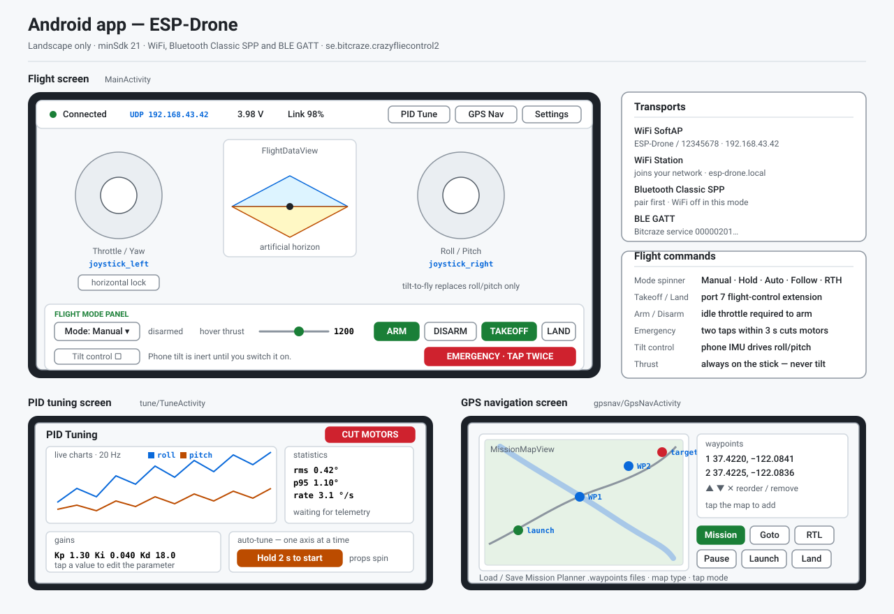

| Tab | Screen | What it is for |
|---|---|---|
| **Fly** | `MainActivity` | flying by hand |
| **Plan** | `gpsnav/PlannerActivity` | the mission editor (Mission Planner Flight Plan) |
| **Mission** | `gpsnav/GpsNavActivity` | flying the mission — zones read-only |
| **Indoor** | `gpsnav/IndoorMapActivity` | the zone/annotation editor (Valetudo map-card style) |
| **Tune** | `tune/TuneActivity` | PID tuning and bench tests |
| **Setup** | `prefs/PreferencesActivity` | settings |

The tabs sit in the header bar on every screen. **Back always returns to Fly**
(Fly's own Back is press-twice-to-exit); **Setup** opens over the current screen
and returns to it. A tab switch is refused with a toast while a **mission
transfer** runs, while the **Mission screen is flying the drone**, or while
**auto-tune** is running — land, stop, or use CUT MOTORS first.

The header, everywhere: tab group · link status (`Not connected` / `Connected` /
`Link NN`) · battery **volts** (amber under 3.5 V, red under 3.3 V) · mode chip
(`MANUAL` `HOLD` `AUTO` `FOLLOW` `RTH`, hidden until connected) · armed chip
(`● ARMED` / `DISARMED`) · **CUT MOTORS**.

## 1.2 Fly screen

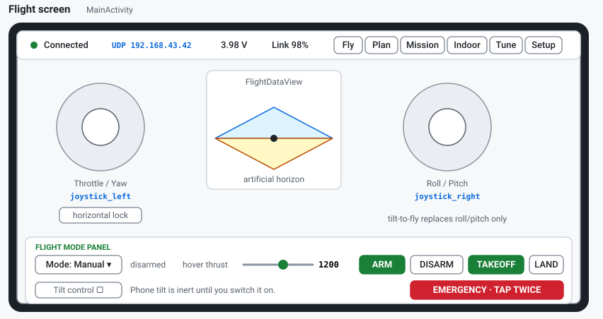

| Control | What it does |
|---|---|
| **Left stick** | thrust (up/down) and yaw (left/right) |
| **Left-stick lock** (icon, top-left of the stick) | locks the horizontal axis — the yaw stick is ignored |
| **Right stick** | roll (left/right) and pitch (up/down) |
| **Flight mode** | `Manual` \| `Hold` \| `Auto` — sends the mode change. `FOLLOW` and `RTH` have no buttons here; they are started from the Mission screen |
| **Takeoff** / **Land** | one button that swaps with the armed state: Takeoff arms, climbs to the hover thrust and holds; Land ramps the thrust down and disarms |
| **ROLL / PITCH / SEQUENCE / FLIGHT** | live cells: the two angles, the auto-sequence state (`idle` `takeoff` `hold` `land`) and the time since arming |
| **More** | opens the More panel |
| **Connect** (not connected) | connects using Setup's connection method; the card also lists the steps for the current link type |
| **CUT MOTORS** (header) | **tap twice within 3 s** — the button turns orange and reads `TAP AGAIN: CUT`. Disabled when not connected |

Both sticks dim to 45 % whenever the flight mode is not **Manual** — only
Manual steers.

**More panel** (slides in from the right):

| Control | What it does |
|---|---|
| **Hover thrust** | slider (8000–55000) for what Takeoff and Hold hold — written to the drone on release |
| **Tilt** (`Tilt: OFF` / `TILT ON`) | tilt-to-fly: phone attitude replaces **roll/pitch only**; inert until switched on |
| **Arm / Disarm** | bench buttons; arming needs the throttle at zero |
| **Deck icons** | LED ring / headlight / buzzer — shown only if the drone reports that deck hardware (this board does not) |
| **STICK OUTPUT** | `P: R: T: Y:` live stick values |
| **DRONE LOG** | drone console tail; long-press to clear |
| **Disconnect** | drops the link |

## 1.3 Plan screen — the mission editor

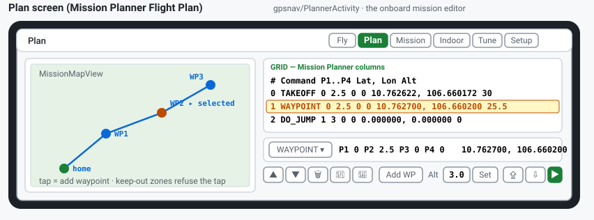

| Control | What it does |
|---|---|
| **Map tap** | adds a waypoint at that spot with the current Alt. A tap inside a keep-out zone is **refused** ("Cannot place waypoint: inside keep-out zone - move the waypoint") |
| **Grid** | one row per item — `# / Command / P1–P4 / Lat / Lng / Alt`. Tap selects a row |
| **Command spinner** | the MAV_CMD names (WAYPOINT, TAKEOFF, LAND, RETURN_TO_LAUNCH, DO_JUMP, …) |
| **P1–P4, Lat, Lng** | row editor — commits when a box loses focus or a command is picked |
| **Alt + Set** | applies the altitude to the selected row; with no selection it sets the default for new waypoints |
| **Add WP** | appends a waypoint (on top of the last one if the map has none) |
| **↑ ↓ ✕ 📁 💾** | move item up/down, delete selected, **Load / Save mission file** |
| **Upload / Download / Start** | the onboard mission over CRTP port 7 channel 2 (PROTOCOL.md §12). Upload writes the grid to the drone, Download reads it back, Start flies **the stored** mission (arming first) |

The status line under the header carries the transfer progress
(`Uploading 3/12`, `Mission downloaded (8 items)`, `flying item 3 of 8`) and
the results (`Mission uploaded`, `Upload failed: …`, `Mission started`,
`Start refused`, `No reply from the drone`).

## 1.4 Mission screen — fly the plan

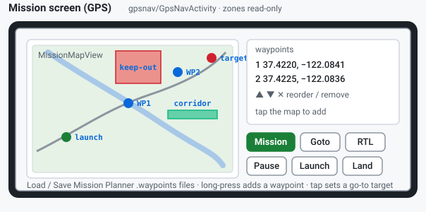

The map shows the plan and the keep-out zones **read-only**; the drone marker
is **estimated dead reckoning** and drifts metres per minute — the red line
under the header says so.

| Button | What it does |
|---|---|
| **Launch** | the ALIGN step: takes the phone's GPS fix and compass heading as the launch frame, marks home, arms and takes off. Refuses on a bad fix ("Waiting for a GPS fix", "GPS accuracy … cannot ALIGN on a bad fix", "No compass heading - cannot ALIGN"). One launch per arming cycle — after landing, CUT MOTORS resets and re-ALIGNs |
| **Mission** | validates the plan against the zones (`Cannot start mission: …`) and flies the waypoints |
| **Go to here** | GUIDED to the shared target (set by a map tap in `Tap: go-to` mode, or on the Indoor screen) |
| **Pause / Resume** | holds the drone; Resume doubles as the pilot's keep-out override |
| **End mission** | stops navigation and clears the target — the drone holds |
| **Return home** | RTH to the launch point (Launch first) |
| **Land** | ramps the thrust down |
| **Map: satellite/street** | map type, state shown on the button |
| **Tap: add WP / go-to** | what a map tap does, state shown on the button |

Every flight button refuses before Launch: "Launch first (ALIGN fixes the
launch frame)". The waypoint tools (↑ ↓ ✕ 📁 💾) reorder and edit the list.
**CUT MOTORS** is **one tap** here, and also resets the launch state.

## 1.5 Indoor Map screen — the zone editor

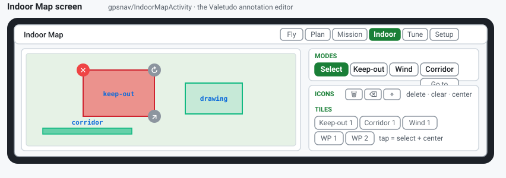

| Mode | Gesture |
|---|---|
| **Select** | tap a shape to edit it — drag the handles, drag the body to move |
| **Keep-out** / **Wind** | drag a rectangle on the map |
| **Corridor** | tap the two endpoints |
| **Go to** | tap sets the GUIDED target that the Mission screen flies |

The icon row is **Delete selected**, **Clear all annotations** and **Center**
(centres the map on the selected object). The tiles row lists every shape
("Keep-out 1", "Corridor 1", "Wind 1", "WP 1", …) — tap to select and centre.
On release, shapes snap to **5° and whole metres**. Placed zones veto Plan and
Mission placement everywhere else in the app.

## 1.6 Tune screen — PID tuning and bench tests

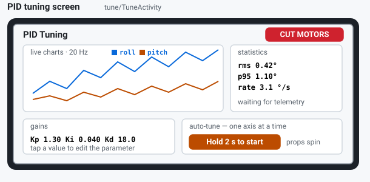

Opens only over a live connection, else it says so and closes. The charts pane
is pinned at the top: **Axis** spinner (Roll / Pitch / yaw), **Pause / Resume
charts**, **Clear charts**, two live charts (angle vs. controller output, then
P/I/D) and a statistics block (n, min, max, mean, σ, RMS).

| Section | Control | What it does |
|---|---|---|
| **Auto-tune** | Method | 11 methods (ML (Bayesian) is the default — fewest trials; Neural, RL, CMA-ES, Differential evolution, PSO, Genetic, Nelder-Mead, SPSA, Twiddle, Random) |
| | Trials / Trial s | 2–200 / 2–30 s per trial |
| | start button | **press and hold 2 s** ("Hold 2 s to start - props spinning; secure the drone on a stand or hold it tethered") |
| | Stop tuner | stops after the current trial |
| **Gains row** | Save / Load / Defaults | the drone's flash (NVS) — **not** phone files |
| **Bench motor test** | M1–M4 sliders + Start/Stop test | spins single motors with the PID bypassed, **disarmed only**; the link re-sends every 200 ms and the firmware stops the motors after 300 ms of silence — leaving the screen or losing the link stops them |
| **Parameters** | 13 rows | `pid.roll/pitch/yaw _kp/_ki/_kd`, hover thrust, takeoff ramp, land ramp, nav Kp — field plus −10 %/+10 %; written live unless the tuner owns the gains |

Auto-tune refuses while a bench motor test runs ("Stop the bench motor test
first") and offers to arm first ("Drone not armed — Arm it now?"). If the drone
tips during a trial the tuner restores the best gains found so far and waits
for the drone to be righted. The model's best **predicted** cost is reported as
text after each trial.

## 1.7 Setup

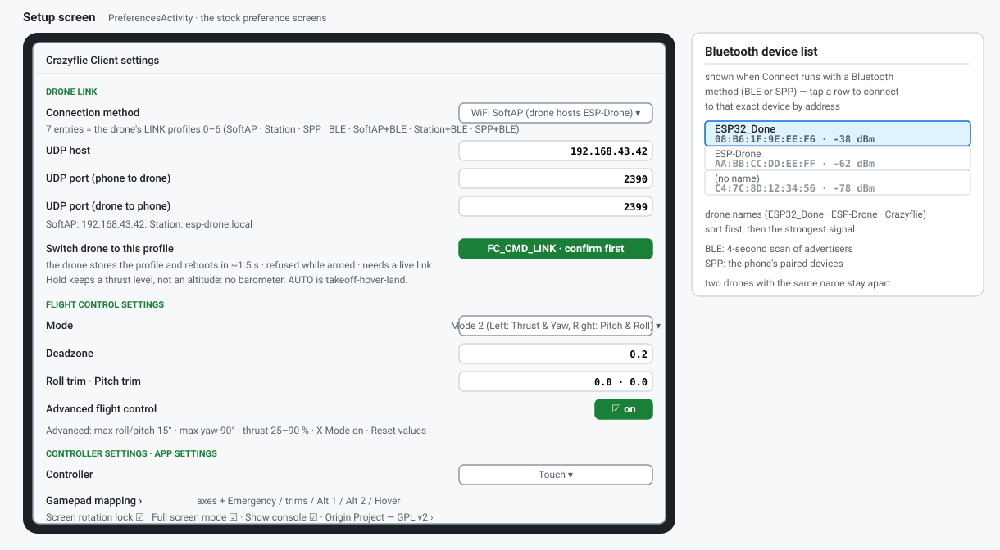

| Group | Setting | Default |
|---|---|---|
| **Drone link** | Connection method: WiFi SoftAP / WiFi Station / Bluetooth Classic (SPP) / Bluetooth LE (GATT) | WiFi SoftAP |
| | UDP host | `192.168.43.42` (Station: `esp-drone.local`) |
| | UDP port (phone to drone) / (drone to phone) | 2390 / 2399 |
| **Flight control** | Mode 1–4 (which stick does what) | Mode 2 — left: thrust & yaw, right: pitch & roll |
| | Deadzone / Roll trim / Pitch trim | 0.2 / 0.0 / 0.0 |
| | Advanced flight control ("Crazy mode") | on |
| | → Max roll/pitch angle · Max yaw angle · Max/Min thrust % · X-Mode | 15° · 90° · 90 / 25 % · on |
| **Controller** | Controller: Touch / Gamepad | Touch |
| | Gamepad axis and button mapping | per-key screen (Emergency stop, trims, Alt 1/2, Hover) |
| | Use gyroscope sensors / amplification / full-travel thrust / virtual joystick size | off / 2 / off / 100 % |
| **App settings** | Screen rotation lock / Full screen mode / Show console | on / on / on |
| **Origin Project** | — | shows the GPL v2 license |

## 1.8 Files

| File | Where | Format |
|---|---|---|
| Mission files | Plan and Mission screens, 📁/💾 | **Mission Planner `.waypoints`** — QGC WPL 110, tab-separated, row 0 = home. Bad lines are skipped and counted: "Mission loaded - N invalid line(s) skipped" |

---

# 2. iOS app

`Crazyflie client`, iOS 15+, Fly landscape and Mission / Indoor / Tune
portrait. Transports: WiFi SoftAP, WiFi Station and BLE GATT. **Bluetooth
Classic SPP is not available on iOS** — it is listed in the link picker but
says so on screen ("Not available on iOS") rather than failing.

## 2.1 Screens and navigation

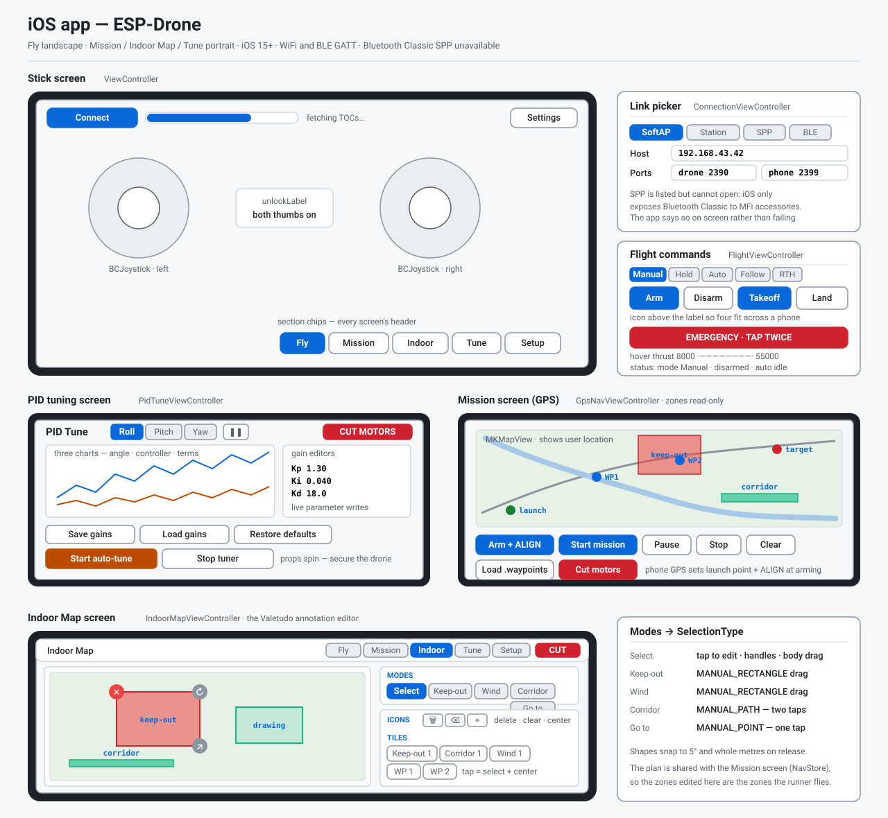

| Chip | Screen | What it is for |
|---|---|---|
| **Fly** | `ViewController` | flying by hand (the root screen) |
| **Plan** | `PlannerViewController` | the mission editor (Mission Planner Flight Plan) |
| **Mission** | `GpsNavViewController` | flying the mission — zones read-only |
| **Indoor** | `IndoorMapViewController` | the zone/annotation editor |
| **Tune** | `PidTuneViewController` | PID tuning and bench tests |
| **Setup** | action sheet | → Link picker and Sticks and sensitivity |

Every section opens as a full-screen modal over Fly; the chips in its header
switch sections (the current modal is dismissed first), **Done** returns to
Fly. Tab switches are refused while a mission transfer runs, while a mission
is flying, or while auto-tune runs. On modal screens the header also carries
the voltage + armed status on the left and **CUT MOTORS** on the right.

## 2.2 Fly screen

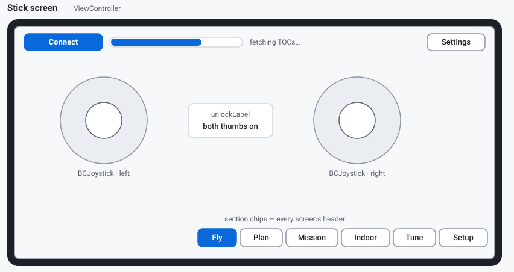

| Control | What it does |
|---|---|
| **Connect / Cancel** (not connected) | connects with a 0–100 % progress bar; the card lists the three steps for the current link type ("Link: WiFi SoftAP · change it in Setup") |
| **Flight mode** | `Manual` \| `Hold` \| `Auto` segments. `FOLLOW` and `RTH` live on the Mission screen |
| **Takeoff / Land** | one button that swaps with the armed state: Takeoff arms, climbs to hover thrust 30000 and holds; Land ramps down and disarms |
| **ROLL / PITCH / SEQUENCE / FLIGHT** | live cells: angles, auto-sequence state, time since arming |
| **Left / right pads** | `BCJoystick` touch sticks; both thumbs must be on the pads to steer, and they dim to 45 % in any mode except Manual |
| **More** | hover thrust slider (8000–55000), the **Yaw on the left stick** switch (off by default — "the yaw stick is ignored, so the nose cannot turn by accident"), **All flight modes and sequence…**, and the DRONE LOG tail |
| **CUT MOTORS** (header) | **tap twice within 3 s** (`TAP AGAIN`), with a haptic |

**All flight modes and sequence…** opens the landscape flight modal: `Manual |
Hold | Auto | Follow | RTH` segments, `Arm · Disarm · Takeoff · Land`
(icon-over-label), the hover-thrust slider, the status lines ("mode MANUAL
ARMED", "auto sequence: idle/takeoff/hold/land", "battery 3.95 V") and the
hardware-limits notice (PROTOCOL.md §5). CUT MOTORS there is also two taps.

## 2.3 Plan screen — the mission editor

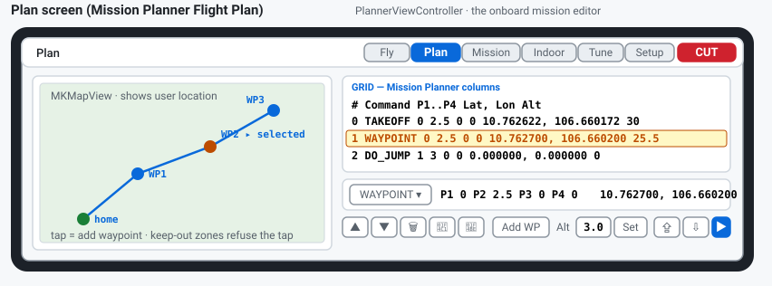

Same model as Android's Plan screen, in a portrait layout:

| Control | What it does |
|---|---|
| **Map tap** | adds a waypoint at the Alt height (radius 2.5 in P2); refused inside keep-out zones |
| **Grid** | `#n / COMMAND / alt x / P1..P4 / lat, lon` — tap selects the row for the editor |
| **WAYPOINT ▾ + P1–P4 + Lat/Lng** | the row editor, commits on end editing |
| **↑ ↓ ✕ 📁 💾** | move, delete, **Load / Save mission file** (`.waypoints`) |
| **Add WP / Alt / Set** | append a waypoint; Set writes the altitude to the selected row, else it becomes the default ("New waypoints will use alt 3.0") |
| **Upload / Download / Start** | the onboard mission (CRTP port 7 ch 2). Start flies the **stored** mission and arms first |

CUT MOTORS in the header is **one tap** on this screen.

## 2.4 Mission screen — fly the plan

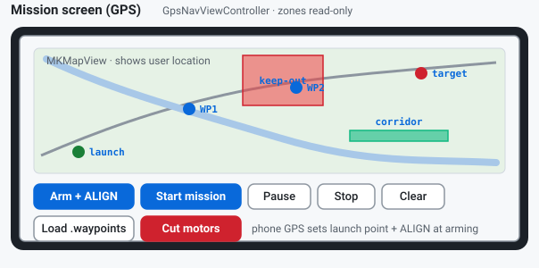

MapKit with the user location, the plan polyline, `Home`, `WP1…`, a purple
**Guided** pin and an orange **Drone (estimated)** pin (dead reckoning, not
GPS). Zones are read-only. A map **tap** sets the GUIDED target, a
**long-press** adds a waypoint — both refused inside zones. The status line
shows "GPS accuracy 8.4 m" (or "holding — waiting for a better fix." over
15 m) and live "dist 12.3 m bearing 84°".

| Control | What it does |
|---|---|
| **MISSION \| GUIDED \| RTL** | what Start will do |
| **Arm + ALIGN** | arms and captures the phone fix + magnetic heading as the launch frame; refuses without a fix ("No phone GPS fix yet — cannot ALIGN.") |
| **Start mission** | validates the plan against the zones (`Cannot start mission: …`, `No waypoints to fly.`) and flies it; GUIDED needs a map tap first, RTL needs home |
| **Pause / Resume** | "Paused — drone holds after 3 s."; Resume doubles as the keep-out override |
| **End mission** | stops and returns to manual sticks (deliberately not red — red is reserved for CUT MOTORS) |
| **Load waypoints / Clear plan** | 📁 loads a `.waypoints` file (zone rows are understood), ✕ clears |
| **CUT MOTORS** (header) | **one tap** — also stops the mission |

## 2.5 Indoor Map screen — the zone editor

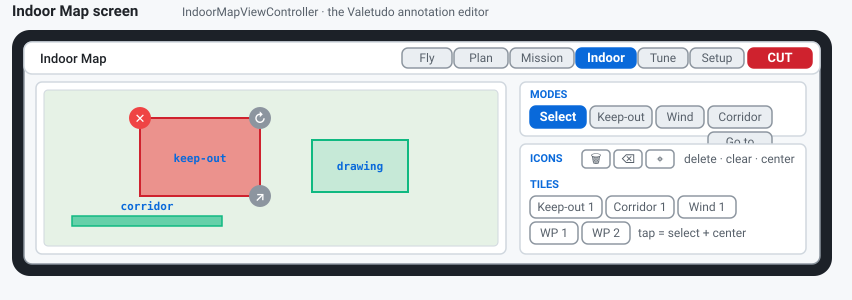

The same editor as Android's Indoor screen, in portrait: mode chips **Select /
Keep-out / Wind / Corridor / Go to** with a flash hint per mode, the icon row
(🗑 delete selected · ⌫ clear all · ⌖ centre), the tiles row of shapes and
waypoints, and the status line. Shapes snap to 5° and whole metres on release.
The Go-to target is shared with the Mission screen.

## 2.6 Tune screen — PID tuning and bench tests

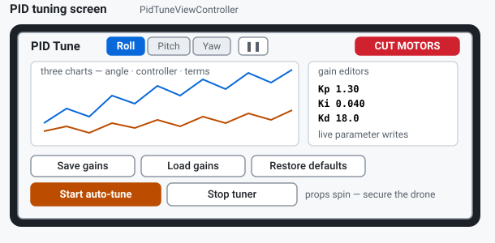

| Section | Control | What it does |
|---|---|---|
| **Charts** | Roll / Pitch / Yaw segments, ❚❚ pause | three charts per axis: angle vs target, controller output (±1000 markers), P/I/D terms; a stats line (n, min, max, mean, σ, RMS) |
| **Auto-tune model** | `ModelView` | trial costs (log axis) and the predicted cost vs the gains (band = 2 std, or a dark-better map for two gains) |
| **Parameters** | 13 rows | `pid.roll_kp … pid.yaw_kd`, `flight.hover_thrust`, `flight.takeoff_ms`, `flight.land_ms`, `nav.kp` — field + −10 %/+10 % + a one-line hint; written live |
| | Save gains / Load gains / Restore defaults | the **drone's flash**, not phone files ("Saved to flash.", "Loaded from flash.", "Restored firmware defaults.") |
| **Bench motor test** | M1–M4 sliders (1000–2000 µs) + Start/Stop test | disarmed only ("Refused — disarm first."); re-sends every 200 ms, firmware watchdog stops it after 300 ms of silence |
| **Auto-tune** | method segments | ML (Bayesian) is the default ("Gaussian process + expected improvement. Fewest trials; the default."); also Neural, RL, CMA-ES, Differential evolution, PSO, Genetic, Nelder-Mead, SPSA, Twiddle, Random |
| | **Hold to confirm — start auto-tune** | press and **hold 1.5 s** ("KEEP HOLDING…"), then confirm — or "Arm and start" if the drone is disarmed |
| | **CUT MOTORS — stop tuner** | one tap: motors off **and** tuner halted |

SAFETY text in red precedes the start button — the props WILL spin during a
trial. Trial status reads "trial 3/12 cost 0.412 best …"; the finish line
reports the gain before/after.

## 2.7 Setup — Link and Sticks

The Setup chip opens an action sheet with two entries.

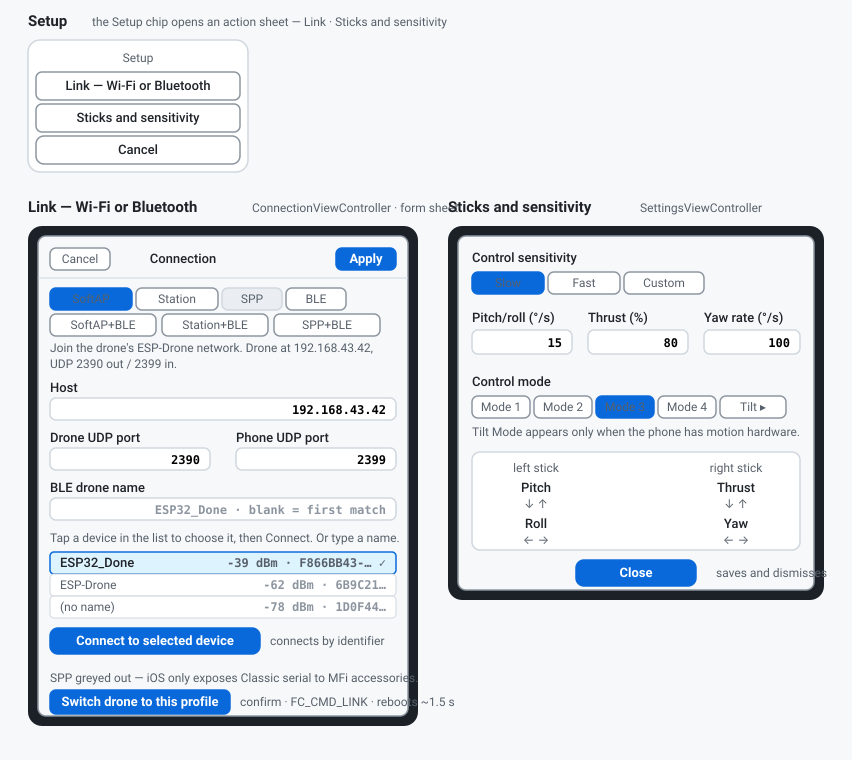

**Link — Wi-Fi or Bluetooth** (`ConnectionViewController`, Cancel / Apply):

| Control | Notes |
|---|---|
| Link type segments | WiFi SoftAP · WiFi Station · Bluetooth Classic (SPP) · Bluetooth LE (GATT), with a detail caption per type |
| Host / ports | `192.168.43.42` or `esp-drone.local`; drone 2390 / phone 2399 (UDP types only) |
| SPP | listed but blocked on iOS ("iOS only exposes Bluetooth Classic serial to MFi accessories"); Apply reports "Not available on iOS" |
| BLE | "Scanning for drones advertising the Bitcraze service… first match is used" |

**Sticks and sensitivity** (`SettingsViewController`, landscape, Close saves):

| Control | Notes |
|---|---|
| Control sensitivity | Slow / Fast / Custom — Slow: pitch/roll 15 °/s, yaw 100 °/s, thrust 80 %; Fast: 25 / 200 / 90; Custom: 30 / 400 / 90. The fields are editable in Custom |
| Control mode | Mode 1–4, plus **Tilt Mode** when the phone has motion hardware. Default Mode 3: left stick pitch/roll, right stick thrust/yaw |
| Stick map | the 2×2 map of which stick does what, updated live with the mode |

## 2.8 Files

| File | Where | Format |
|---|---|---|
| Mission files | Plan 💾/📁 | **Mission Planner `.waypoints`** (QGC WPL 110) via the document picker; export writes `mission.waypoints`. Bad lines counted: "Mission loaded - N invalid line(s) skipped" |
| Waypoint files | Mission 📁 | the same codec plus the map-annotation rows (command 31000) that rebuild keep-out/corridor/wind zones: "Loaded 7 waypoints (123 m)" |

---

# 3. Python tuner app

`tools/pid-tune/tuner_gui.py` — a tkinter + matplotlib bench tool over the
same CRTP/UDP link as the phones. Install and the eleven search methods are in
**[../tools/pid-tune/README.md](../tools/pid-tune/README.md)**. CLI:
`python tuner_gui.py --host 192.168.43.42 --axis roll` — flags `--host`
(192.168.43.42), `--device-port` (2390), `--app-port` (2399), `--axis`
(roll/pitch/yaw), `--window` (10 s of plots).

## 3.1 The tuner window

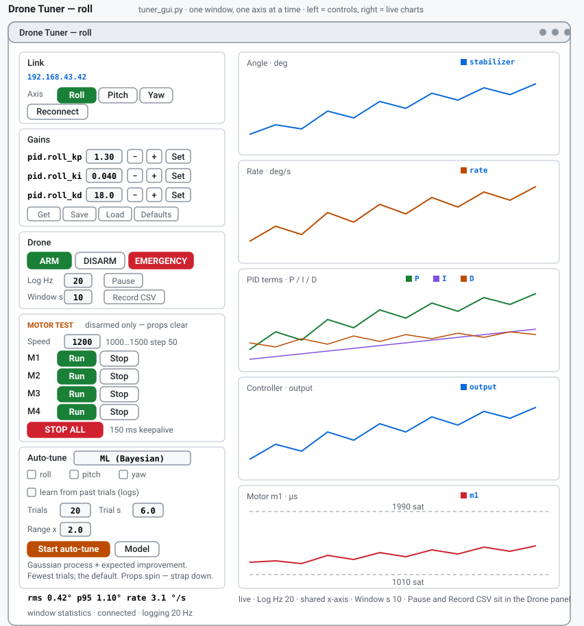

| Panel | Control | What it does |
|---|---|---|
| **Link** | address, axis, Reconnect | changing axis tears down both log blocks and rebuilds them |
| **Gains** | P / I / D fields with − + | clamped by the firmware: kp 0–100, ki 0–20, kd 0–200 |
| | Get / Set / Save / Load / Defaults | read back from the drone, write to it, persist to NVS, reload |
| **Drone** | ARM / DISARM / EMERGENCY | EMERGENCY is always available and stops the motors |
| | rate / window / Pause / Record CSV | telemetry rate (20 Hz default), seconds of plot history, freeze, CSV capture |
| **Motor test** | Speed (1000–1500, 1000 = stopped) | shared speed for all four motors |
| | Run / Stop × M1–M4 | Run spins **only that** motor and parks the other three at 1000; Stop parks its motor keeping the rest |
| | STOP ALL | ends the test at once (enable = 0) |
| **Auto-tune** | method dropdown, gain checkboxes, learn from past trials | the same eleven methods; uncheck a gain to hold it fixed; history seeding from `ml_tune_log.csv` |
| | Trials / Trial s / Range x | the search budget and the multiplicative search box |
| | Start / Stop · **Model** | runs in a worker thread; Model opens the model window |
| **Charts** | five stacked plots | angle (stabilizer), rate, P/I/D terms, controller output, motor m1 with the saturation rails 1990 / 1010 |

While any motor spins, the GUI re-sends the motor-test packet every 150 ms —
the firmware stops the test after 300 ms of silence. Disarmed bench use only;
a refused ack is reported on the status line ("motor test not acked — drone
must be disarmed").

## 3.2 The Model window — Auto-tune model

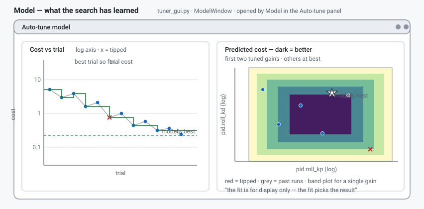

| Plot | What it shows |
|---|---|
| **Cost vs trial** | every trial cost on a log axis — `x` marks a tipped trial, the green step line is the best trial so far, the dashed line is the model's best |
| **Predicted cost** | the GP's prediction over the tuned gains — a dark-better map for two gains (red = tipped, grey = past runs, star = the model's best), or a curve with a 2-std band for one gain |

The fit is for display only; the fit picks the result only.

## 3.3 The Plan window — Mission Planner Flight Plan

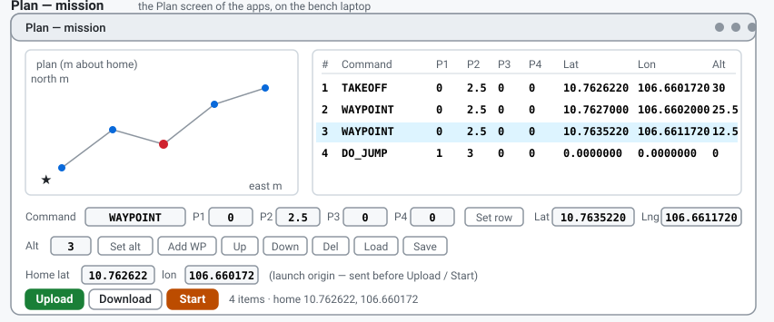

**Mission plan → Open plan window** opens the same editor the phone apps have,
on the laptop:

| Control | What it does |
|---|---|
| **Plan plot** | the plan in metres about home (PROTOCOL.md §12); click adds a waypoint. The PC has no map database, so nothing is vetoed — the phone apps refuse taps in keep-out zones |
| **Grid + row editor** | Command (the five flown commands or any MAV_CMD number), P1–P4, Lat, Lng, Alt; commits with **Set row** or on focus-out |
| **Alt / Set alt / Add WP / ↑ ↓ Del** | the altitude new waypoints get (Set alt also writes the selected row) and row order |
| **Home lat / lon** | the typed launch origin — becomes the file's home row and the ORIGIN sent before Upload or Start (the drone flies a dead-reckoned local frame) |
| **Load / Save** | `.waypoints`, QGC WPL 110 — round-trips byte-for-byte with Mission Planner |
| **Upload / Download / Start** | the onboard mission (port 7 ch 2); the transfer re-sends every 500 ms and gives up after 10 tries ("No reply from the drone") |

## 3.4 Files

| File | Where | Format |
|---|---|---|
| Mission files | Plan window, Load/Save | **Mission Planner `.waypoints`** (QGC WPL 110) |
| `ml_tune_log.csv` | written per trial | `trial, stage, gain0..2, cost, fell, angle_mean, angle_std, rate_rms, motor_rms, control_effort, sat` — feeds "learn from past trials" |

---

# 4. Shared: files, zones and the mission wire

**Mission files** — all three clients read and write the same Mission Planner
`.waypoints` files (QGC WPL 110): a `QGC WPL 110` header, then
tab-separated rows `index current frame command p1 p2 p3 p4 lat lon alt
autocontinue`, row 0 = home. Plans made in Mission Planner or QGroundControl
load as-is.

**Keep-out zones** — drawn on the Indoor Map screen (the Android and iOS
apps share them app-wide). They veto map taps, go-to targets and plan
validations anywhere in the app, and a drone that drifts into a zone holds
until **Resume**.

**The mission wire** — the Plan screens talk to the onboard mission engine
over CRTP port 7 channel 2 (`MISSION_*`, PROTOCOL.md §12): Upload / Download
/ Start / set-current with a 500 ms resend and 10 tries. The Home position
goes first as the flight **ORIGIN**, because the drone itself has no GPS.
