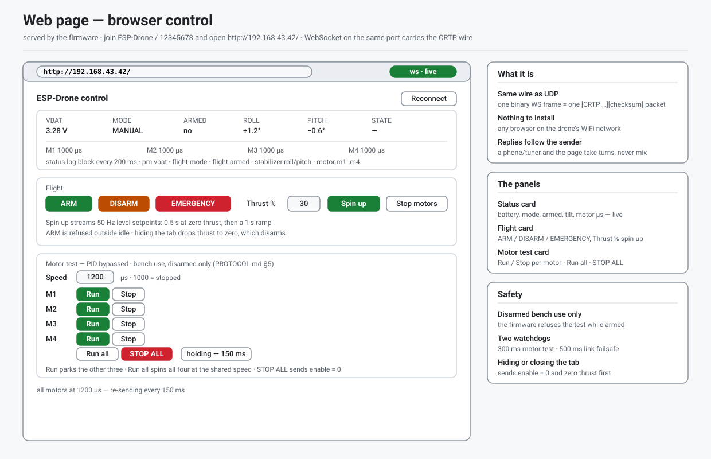

# Hướng dẫn ứng dụng — từng màn hình của bốn ứng dụng

*English: [APP_GUIDE.md](APP_GUIDE.md)*

Tham chiếu theo từng màn hình cho **ứng dụng Android**, **ứng dụng iOS**,
**ứng dụng Python tuner** và **trang Web** của drone: mọi nút bấm làm gì, mọi
cài đặt nghĩa là gì, và màn hình nào đọc/ghi định dạng tệp nào. Các ảnh chụp là
bản vẽ SVG dạng screen map. Quy trình bay, an toàn và danh sách kiểm tra trước
chuyến bay nằm trong **[hướng dẫn phi công](USER_GUIDE.vi.md)**; cài đặt nằm
trong **[INSTALL.md](INSTALL.md)**; định dạng truyền tin nằm trong
**[../PROTOCOL.md](../PROTOCOL.md)**.

## Mục lục

1. [Ứng dụng Android](#1-ứng-dụng-android)
2. [Ứng dụng iOS](#2-ứng-dụng-ios)
3. [Ứng dụng Python tuner](#3-ứng-dụng-python-tuner)
4. [Trang Web](#4-trang-web)
5. [Dùng chung: tệp, vùng cấm và đường truyền nhiệm vụ](#5-dùng-chung-tệp-vùng-cấm-và-đường-truyền-nhiệm-vụ)

---

# 1. Ứng dụng Android

`se.bitcraze.crazyfliecontrol2`, minSdk 21, chỉ xoay ngang. Đường truyền:
WiFi SoftAP, WiFi Station, Bluetooth Classic SPP và BLE GATT — dùng riêng hoặc
trong các hồ sơ chung sống của drone (SoftAP+BLE, Station+BLE, SPP+BLE). Android
12+ xin quyền Bluetooth chạy khi dùng phương thức Bluetooth.

## 1.1 Các màn hình và điều hướng

| Tab | Màn hình | Dùng để |
|---|---|---|
| **Fly** | `MainActivity` | bay điều khiển tay |
| **Plan** | `gpsnav/PlannerActivity` | trình biên soạn nhiệm vụ (Mission Planner Flight Plan) |
| **Mission** | `gpsnav/GpsNavActivity` | bay theo kế hoạch — vùng cấm chỉ xem |
| **Indoor** | `gpsnav/IndoorMapActivity` | trình biên soạn vùng chú thích (kiểu Valetudo map-card) |
| **Tune** | `tune/TuneActivity` | chỉnh PID và thử động cơ trên bệ |
| **Setup** | `prefs/PreferencesActivity` | cài đặt |

Các tab nằm trên thanh tiêu đề của mọi màn hình. **Back luôn quay về Fly**
(tại Fly, Back là nhấn hai lần để thoát); **Setup** mở đè lên màn hình hiện tại
và quay lại màn hình đó. Chuyển tab bị từ chối bằng toast khi đang **truyền
nhiệm vụ**, khi **màn hình Mission đang điều khiển drone**, hoặc khi **đang
auto-tune** — hãy hạ cánh, dừng, hoặc dùng CUT MOTORS trước.

Thanh tiêu đề, ở mọi nơi: nhóm tab · trạng thái liên kết (`Not connected` /
`Connected` / `Link NN`) · **điện áp pin** (vàng dưới 3.5 V, đỏ dưới 3.3 V) ·
chip chế độ (`MANUAL` `HOLD` `AUTO` `FOLLOW` `RTH`, ẩn cho tới khi kết nối) ·
chip trạng thái armed (`● ARMED` / `DISARMED`) · **CUT MOTORS**.

## 1.2 Màn hình Fly

| Điều khiển | Chức năng |
|---|---|
| **Cần trái** | ga (lên/xuống) và yaw (trái/phải) |
| **Khóa cần trái** (biểu tượng góc trên-trái của cần) | khóa trục ngang — cần yaw bị bỏ qua |
| **Cần phải** | roll (trái/phải) và pitch (lên/xuống) |
| **Flight mode** | `Manual` \| `Hold` \| `Auto` — gửi lệnh đổi chế độ. `FOLLOW` và `RTH` không có nút ở đây; chúng được khởi động từ màn hình Mission |
| **Takeoff** / **Land** | một nút đổi theo trạng thái armed: Takeoff arm, bay lên tới mức ga giữ và giữ độ cao; Land giảm ga dần và disarm |
| **ROLL / PITCH / SEQUENCE / FLIGHT** | các ô trực tiếp: hai góc nghiêng, trạng thái chuỗi tự động (`idle` `takeoff` `hold` `land`) và thời gian kể từ khi arm |
| **More** | mở bảng More |
| **Connect** (chưa kết nối) | kết nối theo phương thức trong Setup. Với Bluetooth, trước hết hiện **danh sách thiết bị** — các thiết bị đang quảng bá BLE (quét 4 giây) hoặc thiết bị đã ghép đôi của máy (SPP), tên drone lên trước rồi tới tín hiệu mạnh nhất — và chạm một hàng là kết nối đúng thiết bị đó theo địa chỉ. Thẻ này cũng liệt kê các bước cho kiểu liên kết hiện tại |
| **CUT MOTORS** (đầu trang) | **chạm hai lần trong 3 giây** — nút chuyển màu cam và đọc `TAP AGAIN: CUT`. Tắt khi chưa kết nối |

Hai cần mờ xuống 45 % mỗi khi chế độ bay khác **Manual** — chỉ Manual mới lái.

**Bảng More** (trượt vào từ bên phải):

| Điều khiển | Chức năng |
|---|---|
| **Hover thrust** | thanh trượt (8000–55000) cho mức ga Takeoff và Hold giữ — ghi vào drone khi nhả |
| **Tilt** (`Tilt: OFF` / `TILT ON`) | nghiêng điện thoại để bay: thay **chỉ roll/pitch**; vô hiệu cho tới khi bật |
| **Arm / Disarm** | nút thử trên bệ; arm cần ga về 0 |
| **Deck icons** | LED ring / headlight / buzzer — chỉ hiện nếu drone báo có deck (bản này không có) |
| **STICK OUTPUT** | `P: R: T: Y:` giá trị cần trực tiếp |
| **DRONE LOG** | đuôi bảng console của drone; nhấn giữ để xóa |
| **Disconnect** | ngắt liên kết |

## 1.3 Màn hình Plan — trình biên soạn nhiệm vụ

| Điều khiển | Chức năng |
|---|---|
| **Chạm bản đồ** | thêm điểm đường (waypoint) tại vị trí đó với Alt hiện tại. Chạm vào vùng keep-out bị **từ chối** ("Cannot place waypoint: inside keep-out zone - move the waypoint") |
| **Bảng** | mỗi dòng một mục — `# / Command / P1–P4 / Lat / Lng / Alt`. Chạm để chọn dòng |
| **Command spinner** | tên MAV_CMD (WAYPOINT, TAKEOFF, LAND, RETURN_TO_LAUNCH, DO_JUMP, …) |
| **P1–P4, Lat, Lng** | trình sửa dòng — ghi khi ô mất focus hoặc chọn command |
| **Alt + Set** | áp dụng độ cao cho dòng đã chọn; không có chọn thì đặt mặc định cho waypoint mới |
| **Add WP** | thêm waypoint (kế cuối nếu bản đồ trống) |
| **↑ ↓ ✕ 📁 💾** | di chuyển lên/xuống, xóa đã chọn, **Load / Save mission file** |
| **Upload / Download / Start** | nhiệm vụ trên board qua CRTP port 7 channel 2 (PROTOCOL.md §12). Upload ghi bảng vào drone, Download đọc lại, Start bay nhiệm vụ **đã lưu trữ** (arm trước) |

Dòng trạng thái dưới tiêu đề mang tiến độ truyền (`Uploading 3/12`,
`Mission downloaded (8 items)`, `flying item 3 of 8`) và kết quả
(`Mission uploaded`, `Upload failed: …`, `Mission started`, `Start refused`,
`No reply from the drone`).

Bản đồ nạp các vùng cấm bay / hành lang / gió dùng chung từ màn Indoor ở chế
độ **chỉ xem** — cùng hình với màn Mission, không có tay nắm — vì chạm vào
chúng bị từ chối, và bản đồ tự căn giữa một lần ở fix GPS đầu tiên của điện
thoại.

## 1.4 Màn hình Mission — bay theo kế hoạch

Bản đồ hiển thị kế hoạch và vùng keep-out **chỉ xem**; marker drone là **dead
reckoning ước lượng** và trôi mét mỗi phút — dòng đỏ dưới tiêu đề nói rõ điều đó.

| Nút | Chức năng |
|---|---|
| **Launch** | bước ALIGN: lấy fix GPS và hướng la bàn của điện thoại làm khung xuất phát, đánh dấu home, arm và cất cánh. Từ chối khi fix xấu ("Waiting for a GPS fix", "GPS accuracy … cannot ALIGN on a bad fix", "No compass heading - cannot ALIGN"). Một lần launch cho mỗi chu kỳ arm — sau khi hạ cánh, CUT MOTORS để reset và ALIGN lại |
| **Mission** | kiểm tra kế hoạch với vùng cấm (`Cannot start mission: …`) và bay các waypoint |
| **Go to here** | GUIDED tới mục tiêu chung (đặt bằng chạm bản đồ ở chế độ `Tap: go-to`, hoặc tại màn hình Indoor) |
| **Pause / Resume** | giữ drone; Resume kiêm luôn quyền ghi đè vùng cấm của phi công |
| **End mission** | dừng điều hướng và xóa mục tiêu — drone giữ vị trí |
| **Return home** | RTH về điểm xuất phát (Launch trước) |
| **Land** | giảm ga dần |
| **Map: satellite/street** | kiểu bản đồ, trạng thái hiện trên nút |
| **Tap: add WP / go-to** | chạm bản đồ làm gì, trạng thái hiện trên nút |

Mọi nút bay đều từ chối trước Launch: "Launch first (ALIGN fixes the launch
frame)". Các công cụ waypoint (↑ ↓ ✕ 📁 💾) sắp xếp và sửa danh sách.
**CUT MOTORS** là **một chạm** ở màn hình này, và cũng reset trạng thái launch.

## 1.5 Màn hình Indoor Map — trình biên soạn vùng

| Chế độ | Cử chỉ |
|---|---|
| **Select** | chạm hình để sửa — kéo handle, kéo thân để di chuyển |
| **Keep-out** / **Wind** | kéo một hình chữ nhật trên bản đồ |
| **Corridor** | chạm hai đầu mút |
| **Go to** | chạm để đặt mục tiêu GUIDED mà màn hình Mission sẽ bay tới |

Hàng biểu tượng là **Delete selected**, **Clear all annotations** và
**Center** (căn bản đồ vào đối tượng đã chọn). Hàng tile liệt kê mọi hình
("Keep-out 1", "Corridor 1", "Wind 1", "WP 1", …) — chạm để chọn và căn giữa.
Khi nhả, hình bám **5° và số mét tròn**. Vùng đã đặt sẽ chặn việc đặt điểm tại
Plan và Mission ở mọi nơi khác trong app.

## 1.6 Màn hình Tune — chỉnh PID và thử động cơ

Chỉ mở khi có kết nối trực tiếp, không thì báo rồi tự đóng. Khung biểu đồ ghim
ở trên: spinner **Axis** (Roll / Pitch / yaw), **Pause / Resume charts**,
**Clear charts**, hai biểu đồ trực tiếp (góc vs. tín hiệu điều khiển, rồi
P/I/D) và khối thống kê (n, min, max, mean, σ, RMS).

| Khối | Điều khiển | Chức năng |
|---|---|---|
| **Auto-tune** | Method | 11 phương pháp (ML (Bayesian) là mặc định — ít trial nhất; Neural, RL, CMA-ES, Differential evolution, PSO, Genetic, Nelder-Mead, SPSA, Twiddle, Random) |
| | Trials / Trial s | 2–200 / 2–30 s mỗi trial |
| | nút start | **nhấn giữ 2 giây** ("Hold 2 s to start - props spinning; secure the drone on a stand or hold it tethered") |
| | Stop tuner | dừng sau trial hiện tại |
| **Hàng Gains** | Save / Load / Defaults | flash (NVS) của drone — **không** phải tệp trên điện thoại |
| **Bench motor test** | thanh M1–M4 + Speed / **Run all** + Start/Stop test | quay động cơ bỏ qua PID — từng motor theo thanh trượt, hoặc cả bốn cùng lúc ở giá trị Speed (Run all), **chỉ khi disarmed**; link gửi lại mỗi 150 ms và firmware dừng động cơ sau 300 ms im lặng — rời màn hình hoặc mất link là dừng |
| **Parameters** | 13 dòng | `pid.roll/pitch/yaw _kp/_ki/_kd`, hover thrust, takeoff ramp, land ramp, nav Kp — ô nhập kèm −10 %/+10 %; ghi trực tiếp trừ khi tuner đang giữ gains |

Auto-tune từ chối khi bench motor test đang chạy ("Stop the bench motor test
first") và đề nghị arm trước ("Drone not armed — Arm it now?"). Nếu drone bị
lật trong trial, tuner khôi phục gains tốt nhất tìm được và chờ dựng lại drone.
Cost **dự đoán** tốt nhất của model được báo dạng chữ sau mỗi trial.

## 1.7 Setup

| Nhóm | Cài đặt | Mặc định |
|---|---|---|
| **Drone link** | Connection method: WiFi SoftAP / WiFi Station / Bluetooth Classic (SPP) / Bluetooth LE (GATT) / WiFi SoftAP + BLE / WiFi Station + BLE / Bluetooth SPP + BLE — khớp các hồ sơ `LINK` 0–6 của drone | WiFi SoftAP |
| | UDP host | `192.168.43.42` (Station: `esp-drone.local`) |
| | UDP port (phone to drone) / (drone to phone) | 2390 / 2399 |
| | Danh sách thiết bị Bluetooth | hiện khi bấm **Connect** với phương thức Bluetooth: mọi thiết bị tìm được (quét BLE hoặc SPP đã ghép đôi), tên drone (`ESP32_Done`, `ESP-Drone`, `Crazyflie`) lên trước rồi tới tín hiệu mạnh nhất — chạm một hàng để kết nối đúng thiết bị đó |
| | **Switch drone to this profile** | gửi `FC_CMD_LINK` qua kết nối đang mở sau hộp thoại xác nhận; drone lưu hồ sơ và khởi động lại sau ~1,5 s (từ chối khi đang armed). Chưa kết nối: "Connect to the drone first" |
| **Flight control** | Mode 1–4 (cần nào làm gì) | Mode 2 — trái: ga & yaw, phải: pitch & roll |
| | Deadzone / Roll trim / Pitch trim | 0.2 / 0.0 / 0.0 |
| | Advanced flight control ("Crazy mode") | bật |
| | → Max roll/pitch angle · Max yaw angle · Max/Min thrust % · X-Mode | 15° · 90° · 90 / 25 % · bật |
| **Controller** | Controller: Touch / Gamepad | Touch |
| | Ánh xạ trục và nút gamepad | màn hình theo phím (Emergency stop, trims, Alt 1/2, Hover) |
| | Use gyroscope sensors / amplification / full-travel thrust / virtual joystick size | off / 2 / off / 100 % |
| **App settings** | Screen rotation lock / Full screen mode / Show console | on / on / on |
| **Origin Project** | — | hiện giấy phép GPL v2 |

## 1.8 Tệp

| Tệp | Ở đâu | Định dạng |
|---|---|---|
| Mission files | màn hình Plan và Mission, 📁/💾 | **Mission Planner `.waypoints`** — QGC WPL 110, phân cách bằng tab, dòng 0 = home. Dòng hỏng bị bỏ qua và đếm: "Mission loaded - N invalid line(s) skipped" |

---

# 2. Ứng dụng iOS

`Crazyflie client`, iOS 15+, Fly xoay ngang, Mission / Indoor / Tune dọc.
Đường truyền: WiFi SoftAP, WiFi Station và BLE GATT, gồm các hồ sơ chung sống
(app dùng phía WiFi của SoftAP+BLE / Station+BLE và phía BLE của SPP+BLE).
**Bluetooth Classic SPP không khả dụng trên iOS** — nó bị làm mờ trong trình
chọn link, không chọn được.

Ứng dụng này cũng chạy trên **macOS 12+** (Mac Catalyst): cùng các màn hình
và đường truyền, điều khiển bằng chuột — và **không có chế độ nghiêng máy để
bay trên Mac** (máy Mac không có cảm biến chuyển động), nên dùng các cần gạt
để bay. Mọi phần còn lại trong mục này cũng đúng với app Mac.

## 2.1 Các màn hình và điều hướng

| Chip | Màn hình | Dùng để |
|---|---|---|
| **Fly** | `ViewController` | bay điều khiển tay (màn hình gốc) |
| **Plan** | `PlannerViewController` | trình biên soạn nhiệm vụ (Mission Planner Flight Plan) |
| **Mission** | `GpsNavViewController` | bay theo kế hoạch — vùng cấm chỉ xem |
| **Indoor** | `IndoorMapViewController` | trình biên soạn vùng chú thích |
| **Tune** | `PidTuneViewController` | chỉnh PID và thử động cơ trên bệ |
| **Setup** | action sheet | → Link picker và Sticks and sensitivity |

Mỗi mục mở dạng modal toàn màn hình đè lên Fly; các chip trên tiêu đề của nó
chuyển mục (modal hiện tại đóng trước), **Done** quay về Fly. Chuyển mục bị từ
chối khi đang truyền nhiệm vụ, khi nhiệm vụ đang bay, hoặc khi auto-tune đang
chạy. Trên các màn hình modal, tiêu đề còn mang điện áp + trạng thái armed bên
trái và **CUT MOTORS** bên phải.

## 2.2 Màn hình Fly

| Điều khiển | Chức năng |
|---|---|
| **Connect / Cancel** (chưa kết nối) | kết nối với thanh tiến độ 0–100 %; với BLE, nó đi thẳng tới thiết bị đã chọn trong danh sách của Setup (hoặc kết quả khớp tên đầu tiên). Thẻ liệt kê ba bước cho kiểu link hiện tại ("Link: WiFi SoftAP · change it in Setup") |
| **Flight mode** | các segment `Manual` \| `Hold` \| `Auto`. `FOLLOW` và `RTH` nằm ở màn hình Mission |
| **Takeoff / Land** | một nút đổi theo trạng thái armed: Takeoff arm, bay lên tới hover thrust 30000 và giữ; Land giảm dần và disarm |
| **ROLL / PITCH / SEQUENCE / FLIGHT** | các ô trực tiếp: góc, trạng thái chuỗi tự động, thời gian từ khi arm |
| **Hai pad trái/phải** | cần cảm ứng `BCJoystick`; cả hai ngón cái phải nằm trên pad mới lái, và pad mờ 45 % ở mọi chế độ trừ Manual |
| **More** | thanh trượt hover thrust (8000–55000), công tắc **Yaw on the left stick** (mặc định tắt — "the yaw stick is ignored, so the nose cannot turn by accident"), **All flight modes and sequence…**, và đuôi DRONE LOG |
| **CUT MOTORS** (đầu trang) | **chạm hai lần trong 3 giây** (`TAP AGAIN`), kèm rung |

**All flight modes and sequence…** mở modal bay xoay ngang: các segment
`Manual | Hold | Auto | Follow | RTH`, các nút `Arm · Disarm · Takeoff · Land`
(chữ dưới biểu tượng), thanh hover-thrust, các dòng trạng thái ("mode MANUAL
ARMED", "auto sequence: idle/takeoff/hold/land", "battery 3.95 V") và thông báo
giới hạn phần cứng (PROTOCOL.md §5). CUT MOTORS ở đó cũng là hai chạm.

## 2.3 Màn hình Plan — trình biên soạn nhiệm vụ

Cùng mô hình với màn hình Plan của Android, bố cục dọc:

| Điều khiển | Chức năng |
|---|---|
| **Chạm bản đồ** | thêm waypoint ở độ cao Alt (bán kính 2.5 trong P2); bị từ chối trong vùng keep-out |
| **Bảng** | `#n / COMMAND / alt x / P1..P4 / lat, lon` — chạm để chọn dòng cho trình sửa |
| **WAYPOINT ▾ + P1–P4 + Lat/Lng** | trình sửa dòng, ghi khi kết thúc chỉnh sửa |
| **↑ ↓ ✕ 📁 💾** | di chuyển, xóa, **Load / Save mission file** (`.waypoints`) |
| **Add WP / Alt / Set** | thêm waypoint; Set ghi độ cao cho dòng đã chọn, ngược lại thành mặc định ("New waypoints will use alt 3.0") |
| **Upload / Download / Start** | nhiệm vụ trên board (CRTP port 7 ch 2). Start bay nhiệm vụ **đã lưu trữ** và arm trước |

CUT MOTORS ở tiêu đề màn hình này là **một chạm**. Bản đồ cũng vẽ các vùng
cấm bay / hành lang / gió dùng chung ở chế độ **chỉ xem** — cùng hình với màn
Mission — vì chạm vào chúng bị từ chối.

## 2.4 Màn hình Mission — bay theo kế hoạch

MapKit với vị trí người dùng, đường polyline của kế hoạch, `Home`, `WP1…`,
một pin tím **Guided** và một pin cam **Drone (estimated)** (dead reckoning,
không phải GPS). Vùng cấm chỉ xem. **Chạm** bản đồ đặt mục tiêu GUIDED,
**nhấn giữ** thêm waypoint — cả hai bị từ chối trong vùng cấm. Dòng trạng thái
hiện "GPS accuracy 8.4 m" (hoặc "holding — waiting for a better fix." khi
quá 15 m) và "dist 12.3 m bearing 84°" trực tiếp.

| Điều khiển | Chức năng |
|---|---|
| **MISSION \| GUIDED \| RTL** | Start sẽ làm gì |
| **Arm + ALIGN** | arm và lấy fix điện thoại + hướng từ tính làm khung xuất phát; từ chối khi chưa có fix ("No phone GPS fix yet — cannot ALIGN.") |
| **Start mission** | kiểm tra kế hoạch với vùng cấm (`Cannot start mission: …`, `No waypoints to fly.`) rồi bay; GUIDED cần chạm bản đồ trước, RTL cần home |
| **Pause / Resume** | "Paused — drone holds after 3 s."; Resume kiêm quyền ghi đè vùng cấm |
| **End mission** | dừng và trở về lái tay (cố ý không phải màu đỏ — đỏ dành cho CUT MOTORS) |
| **Load waypoints / Clear plan** | 📁 nạp tệp `.waypoints` (hiểu cả dòng vùng cấm), ✕ xóa |
| **CUT MOTORS** (đầu trang) | **một chạm** — cũng dừng nhiệm vụ |

## 2.5 Màn hình Indoor Map — trình biên soạn vùng

Cùng trình biên soạn với màn hình Indoor của Android, dạng dọc: các chip chế
độ **Select / Keep-out / Wind / Corridor / Go to** với gợi ý theo chế độ, hàng
biểu tượng (🗑 xóa đã chọn · ⌫ xóa hết · ⌖ căn giữa), hàng tile các hình và
waypoint, và dòng trạng thái. Hình bám 5° và số mét tròn khi nhả. Mục tiêu
Go-to dùng chung với màn hình Mission.

## 2.6 Màn hình Tune — chỉnh PID và thử động cơ

| Khối | Điều khiển | Chức năng |
|---|---|---|
| **Charts** | các segment Roll / Pitch / Yaw, ❚❚ pause | ba biểu đồ mỗi trục: góc vs mục tiêu, tín hiệu điều khiển (marker ±1000), các thành phần P/I/D; dòng thống kê (n, min, max, mean, σ, RMS) |
| **Auto-tune model** | `ModelView` | cost các trial (trục log) và cost dự đoán theo gains (band = 2 std, hoặc bản đồ càng tối càng tốt cho hai gains) |
| **Parameters** | 13 dòng | `pid.roll_kp … pid.yaw_kd`, `flight.hover_thrust`, `flight.takeoff_ms`, `flight.land_ms`, `nav.kp` — ô nhập + −10 %/+10 % + một dòng gợi ý; ghi trực tiếp |
| | Save gains / Load gains / Restore defaults | **flash của drone**, không phải tệp trên điện thoại ("Saved to flash.", "Loaded from flash.", "Restored firmware defaults.") |
| **Bench motor test** | thanh M1–M4 (1000–2000 µs) + Speed / **Run all** + Start/Stop test | một chạm quay cả bốn motor cùng lúc ở giá trị Speed, hoặc từng thanh trượt điều khiển live; chỉ khi disarmed ("Refused — disarm first."); gửi lại mỗi 150 ms, watchdog firmware dừng sau 300 ms im lặng (cũng dừng khi app rời foreground) |
| **Auto-tune** | các segment phương pháp | ML (Bayesian) là mặc định ("Gaussian process + expected improvement. Fewest trials; the default."); ngoài ra Neural, RL, CMA-ES, Differential evolution, PSO, Genetic, Nelder-Mead, SPSA, Twiddle, Random |
| | **Hold to confirm — start auto-tune** | nhấn **giữ 1.5 giây** ("KEEP HOLDING…"), rồi xác nhận — hoặc "Arm and start" nếu drone chưa arm |
| | **CUT MOTORS — stop tuner** | một chạm: motors off **và** tuner dừng |

Chữ SAFETY màu đỏ đứng trước nút start — cánh quạt SẼ quay trong mỗi trial.
Trạng thái trial đọc "trial 3/12 cost 0.412 best …"; dòng kết thúc báo gain
trước/sau.

## 2.7 Setup — Link và Sticks

Chip Setup mở một action sheet với hai mục.

**Link — Wi-Fi or Bluetooth** (`ConnectionViewController`, Cancel / Apply):

| Điều khiển | Ghi chú |
|---|---|
| Các segment kiểu link | WiFi SoftAP · WiFi Station · Bluetooth Classic (SPP) · Bluetooth LE (GATT) · WiFi SoftAP + BLE · WiFi Station + BLE · Bluetooth SPP + BLE — khớp các hồ sơ `LINK` 0–6 của drone, kèm chú thích theo từng loại |
| Host / ports | `192.168.43.42` hoặc `esp-drone.local`; drone 2390 / phone 2399 (kiểu UDP và phía WiFi của các hồ sơ chung sống) |
| SPP | bị làm mờ trên iOS ("iOS only exposes Bluetooth Classic serial to MFi accessories") — không chọn được |
| Tên BLE | ô tên drone để quét (trống = quảng bá đầu tiên; drone quảng bá dưới tên `ESP32_Done`); hiện ở các hồ sơ BLE |
| Danh sách thiết bị | bảng sống các thiết bị BLE đang quảng bá (tên, cường độ tín hiệu, định danh), tên drone lên trước rồi tín hiệu mạnh nhất. **Chạm một hàng** để chọn (dấu tick, tên điền vào ô), **Connect to selected device** kết nối đúng thiết bị đó — định danh nó mang theo là thứ link dùng, nên hai drone trùng tên vẫn phân biệt được và lần kết nối sau bỏ qua bước quét. Gõ tay vào ô tên sẽ bỏ thiết bị đã chọn |
| **Switch drone to this profile** | gửi `FC_CMD_LINK` qua kết nối đang mở sau hộp thoại xác nhận; drone lưu hồ sơ và khởi động lại sau ~1,5 s (từ chối khi đang armed). Không bao giờ gửi khi bấm Apply |

**Sticks and sensitivity** (`SettingsViewController`, xoay ngang, Close lưu):

| Điều khiển | Ghi chú |
|---|---|
| Control sensitivity | Slow / Fast / Custom — Slow: pitch/roll 15 °/s, yaw 100 °/s, thrust 80 %; Fast: 25 / 200 / 90; Custom: 30 / 400 / 90. Các ô nhập sửa được ở Custom |
| Control mode | Mode 1–4, cộng **Tilt Mode** khi điện thoại có cảm biến chuyển động. Mặc định Mode 3: cần trái pitch/roll, cần phải thrust/yaw |
| Stick map | bản đồ 2×2 cần nào làm gì, cập nhật theo mode |

## 2.8 Tệp

| Tệp | Ở đâu | Định dạng |
|---|---|---|
| Mission files | Plan 💾/📁 | **Mission Planner `.waypoints`** (QGC WPL 110) qua document picker; xuất ghi `mission.waypoints`. Dòng hỏng được đếm: "Mission loaded - N invalid line(s) skipped" |
| Waypoint files | Mission 📁 | cùng codec cộng các dòng chú thích bản đồ (command 31000) dựng lại vùng keep-out/corridor/wind: "Loaded 7 waypoints (123 m)" |

---

# 3. Ứng dụng Python tuner

`tools/pid-tune/tuner_gui.py` — công cụ bench tkinter + matplotlib dùng chung
link CRTP với điện thoại: UDP, Bluetooth LE hoặc Bluetooth Classic SPP. Cài đặt
và mười một phương pháp tìm kiếm nằm ở
**[../tools/pid-tune/README.md](../tools/pid-tune/README.md)**. CLI:
`python tuner_gui.py --host 192.168.43.42 --axis roll` — cờ `--link`
(udp/ble/spp), `--host` (192.168.43.42), `--device-port` (2390), `--app-port`
(2399), `--ble` (tên, MAC hoặc UUID CoreBluetooth), `--spp` (MAC), `--axis`
(roll/pitch/yaw), `--window` (10 s lịch sử đồ thị). BLE cần `pip install bleak`;
SPP cần drone đã ghép cặp và máy chạy Linux. Liên lạc đầu tiên thất bại không
còn thoát chương trình — cửa sổ vẫn mở, dòng trạng thái nói phải sửa gì, còn
**Devices…** liệt kê thiết bị Bluetooth để chọn.

## 3.1 Cửa sổ tuner

| Bảng | Điều khiển | Chức năng |
|---|---|---|
| **Link** | các radio UDP / BLE / SPP, ô địa chỉ, nhãn link đang mở, axis, Reconnect, **Devices…** | chuyển tầng truyền hoặc địa chỉ (mission hoặc motor test dừng trước); đổi axis sẽ tháo cả hai khối log và dựng lại. Devices… liệt kê thiết bị BLE đang quảng bá hoặc SPP đã ghép đôi (tên drone trước, rồi tín hiệu mạnh nhất) và Connect trên một hàng là kết nối đúng thiết bị đó theo địa chỉ |
| **Gains** | các trường P / I / D với − + | bị firmware kẹp: kp 0–100, ki 0–20, kd 0–200 |
| | Get / Set / Save / Load / Defaults | đọc từ drone, ghi vào, lưu NVS, nạp lại |
| **Drone** | ARM / DISARM / EMERGENCY | EMERGENCY luôn sẵn sàng và dừng động cơ |
| | rate / window / Pause / Record CSV | tần số telemetry (mặc định 20 Hz), số giây lịch sử đồ thị, đóng băng, ghi CSV |
| **Motor test** | Speed (1000–1500, 1000 = dừng) | tốc độ dùng chung cho cả bốn động cơ |
| | Run / Stop × M1–M4 | Run quay **chỉ động cơ đó** và ghim ba động cơ còn lại ở 1000; Stop ghim động cơ của nó, giữ nguyên phần còn lại |
| | **Run all** / STOP ALL | Run all quay **cả bốn** động cơ cùng lúc ở tốc độ dùng chung; STOP ALL kết thúc phép thử ngay (enable = 0) |
| **Auto-tune** | dropdown phương pháp, checkbox gains, learn from past trials | cùng mười một phương pháp; bỏ chọn một gain để giữ cố định; gieo lịch sử từ `ml_tune_log.csv` |
| | Trials / Trial s / Range x | ngân sách tìm kiếm và hộp tìm kiếm nhân |
| | Start / Stop · **Model** | chạy trong worker thread; Model mở cửa sổ model |
| **Charts** | năm đồ thị xếp chồng | góc (stabilizer), rate, các thành phần P/I/D, tín hiệu điều khiển, động cơ m1 với hai rail bão hòa 1990 / 1010 |

Khi bất kỳ động cơ nào quay, GUI gửi lại gói motor test mỗi 150 ms — firmware
dừng phép thử sau 300 ms im lặng. Chỉ dùng trên bệ khi disarmed; ack bị từ chối
được báo trên dòng trạng thái ("motor test not acked — drone must be
disarmed").

## 3.2 Cửa sổ Model — Auto-tune model

| Đồ thị | Hiển thị |
|---|---|
| **Cost vs trial** | cost mỗi trial trên trục log — `x` đánh dấu trial bị lật, đường bậc thang xanh là trial tốt nhất tới hiện tại, đường nét đứt là mức tốt nhất của model |
| **Predicted cost** | dự đoán của GP trên các gain đang tối ưu — bản đồ càng tối càng tốt cho hai gains (đỏ = bị lật, xám = các lần chạy cũ, sao = mức tốt nhất của model), hoặc đường cong với band 2-std cho một gain |

Phép fit chỉ để hiển thị; fit chọn kết quả mới đúng.

## 3.3 Cửa sổ Plan — Mission Planner Flight Plan

**Mission plan → Open plan window** mở cùng trình biên soạn mà các app điện
thoại có, trên máy tính:

| Điều khiển | Chức năng |
|---|---|
| **Plan plot** | kế hoạch theo mét quanh home (PROTOCOL.md §12); click để thêm waypoint. PC không có cơ sở dữ liệu bản đồ nên không có gì bị chặn — các app điện thoại từ chối chạm trong vùng keep-out |
| **Bảng + trình sửa dòng** | Command (năm lệnh bay hoặc số MAV_CMD bất kỳ), P1–P4, Lat, Lng, Alt; ghi bằng **Set row** hoặc khi mất focus |
| **Alt / Set alt / Add WP / ↑ ↓ Del** | độ cao waypoint mới nhận (Set alt cũng ghi vào dòng đã chọn) và thứ tự dòng |
| **Home lat / lon** | điểm xuất phát nhập tay — thành dòng home của tệp và ORIGIN gửi trước Upload hoặc Start (drone bay theo khung local dead-reckoned) |
| **Load / Save** | `.waypoints`, QGC WPL 110 — khớp từng byte với Mission Planner |
| **Upload / Download / Start** | nhiệm vụ trên board (port 7 ch 2); truyền gửi lại mỗi 500 ms và bỏ cuộc sau 10 lần ("No reply from the drone") |

## 3.4 Tệp

| Tệp | Ở đâu | Định dạng |
|---|---|---|
| Mission files | cửa sổ Plan, Load/Save | **Mission Planner `.waypoints`** (QGC WPL 110) |
| `ml_tune_log.csv` | ghi mỗi trial | `trial, stage, gain0..2, cost, fell, angle_mean, angle_std, rate_rms, motor_rms, control_effort, sat` — nuôi "learn from past trials" |

---

# 4. Trang Web

Firmware phục vụ trang này tại **`http://192.168.43.42/`** — vào WiFi của drone
(soft-AP **ESP-Drone** / **12345678**) rồi mở địa chỉ trong bất kỳ trình duyệt
nào: điện thoại, máy tính bảng hay laptop, không cần cài gì. Trang nói chuyện
với board qua **WebSocket** trên cùng cổng, mang đúng byte CRTP mà liên kết UDP
mang ([PROTOCOL.md §8](../PROTOCOL.md#8-transports)), nên mọi nút ở đây đúng
nghĩa như trong các app và tuner.

## 4.1 Thẻ trạng thái

| Mục | Ý nghĩa |
| --- | --- |
| **viên link** | `live` = WebSocket lên và telemetry đang về; `no reply` = socket mở nhưng drone im lặng 1,5 s; `lost` = đang kết nối lại mỗi 2 s |
| **VBAT / MODE / ARMED** | volt pin, chế độ bay (Manual / Hold / Auto / Follow / Rth) và cờ armed, từ khối log trạng thái mỗi 200 ms |
| **ROLL / PITCH / STATE** | góc cân bằng theo độ; STATE là tiểu trạng thái auto (Idle / Takeoff / Hold / Land) khi ở Auto |
| **M1–M4** | bốn output động cơ theo µs đúng như firmware ghi ra — trong thử bàn đây là tốc độ thử |

## 4.2 Thẻ điều khiển bay

| Điều khiển | Làm gì |
| --- | --- |
| **ARM / DISARM** | ARM / DISARM port 7 (PROTOCOL.md §5); ARM bị từ chối trừ khi drone khởi động từ trạng thái nghỉ, và mọi thứ bị từ chối đều báo "refused by the drone" |
| **EMERGENCY** | một nhấp, không xác nhận: tắt motor + disarm ngay |
| **Thrust % + Spin up** | phát CommanderPackets cân bằng 50 Hz (§7): 0,5 s ở lực đẩy không, rồi bám 1 s tới % đã chọn (tối đa 60). Lực đẩy lên làm drone arm; **Stop motors** (hoặc giấu tab) đưa lực đẩy về không, tức là disarm |
| **Stop motors** | kết thúc luồng bằng các gói lực đẩy không |

ARM chỉ giữ trong khi luồng setpoint đang chạy: ở Manual luồng đó CHÍNH LÀ
setpoint, và failsafe 500 ms disarm nửa giây sau khi nó dừng.

## 4.3 Thẻ thử động cơ

Bàn thử của PROTOCOL.md §5, giống hệt bảng Motor test của tuner: **Speed** dùng
chung (1000–2000 µs), một cặp **Run** / **Stop** cho từng motor M1–M4, **Run
all** và **STOP ALL**. Run đỗ ba motor còn lại; Stop đưa một motor về 1000 giữ
nguyên trạng thái các motor khác; Run all chạy cả bốn ở tốc độ dùng chung (một
gói `enable=1` mang bốn tốc độ); STOP ALL gửi `enable=0`. Trong khi có motor
quay trang gửi lại gói mỗi 150 ms, vì firmware dừng thử sau 300 ms im lặng.
Chỉ dùng trên bàn khi chưa armed — firmware từ chối thử khi đang armed và trang
không bao giờ tự arm drone cho việc này.

## 4.4 An toàn

Giấu hoặc đóng tab sẽ gửi `enable=0` và lực đẩy không trước khi socket đóng,
watchdog 300 ms của firmware bắt mọi thứ mất trên đường, và failsafe liên kết
500 ms dừng motor nếu WiFi chết. Tháo cánh quạt hoặc cố định drone, như mọi
công cụ bàn khác.

---

# 5. Dùng chung: tệp, vùng cấm và đường truyền nhiệm vụ

**Mission files** — cả ba ứng dụng đọc và ghi cùng loại tệp Mission Planner
`.waypoints` (QGC WPL 110): tiêu đề `QGC WPL 110`, rồi các dòng phân cách tab
`index current frame command p1 p2 p3 p4 lat lon alt autocontinue`, dòng 0 =
home. Kế hoạch làm trong Mission Planner hoặc QGroundControl nạp thẳng được.

**Vùng keep-out** — vẽ tại màn hình Indoor Map (hai app Android và iOS dùng
chung trong toàn app). Chúng chặn chạm bản đồ, mục tiêu go-to và việc kiểm tra
kế hoạch ở mọi nơi trong app, và drone trôi vào vùng sẽ giữ cho tới khi
**Resume**.

**Đường truyền nhiệm vụ** — các màn hình Plan nói chuyện với engine nhiệm vụ
trên board qua CRTP port 7 channel 2 (`MISSION_*`, PROTOCOL.md §12): Upload /
Download / Start / set-current với gửi lại 500 ms, 10 lần thử. Vị trí Home
đi trước như **ORIGIN** của chuyến bay, vì bản thân drone không có GPS.
