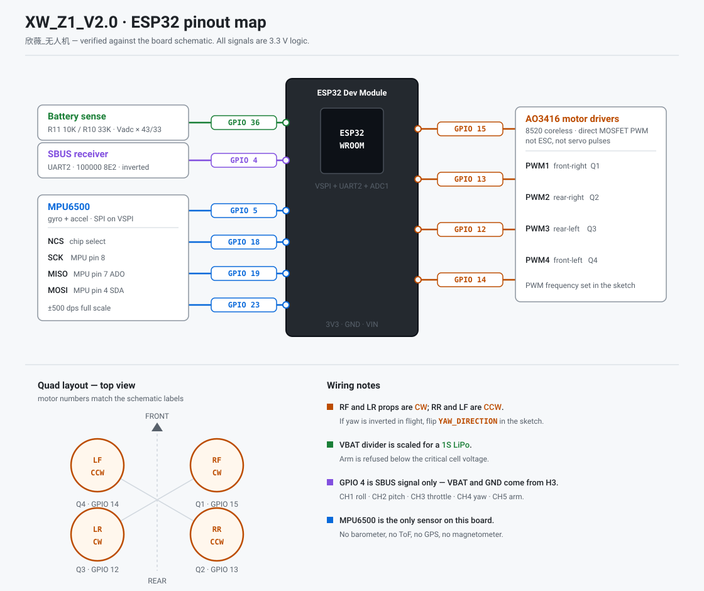

# Installing the apps and the firmware

End-to-end: flash the board, put an app on your phone and connect. How to
*fly* — every screen, CUT MOTORS, arming, the failsafe and a first-flight
checklist — is in the **[pilot's guide](USER_GUIDE.md)**. Protocol details live
in **[../PROTOCOL.md](../PROTOCOL.md)**.

---

## What you need

| | |
|---|---|
| **Board** | XW_Z1_V2.0 欣薇_无人机 — ESP32 Dev Module + MPU6500 (SPI) + SBUS + 4× AO3416 |
| **Motors** | 8520 coreless, direct MOSFET PWM (no ESCs) |
| **Phone** | Android 5.0+ (API 21), or iOS 15+ |
| **Firmware toolchain** | Arduino IDE 2.x **or** `arduino-cli`, plus the ESP32 board package |
| **Android toolchain** | Android Studio, or a JDK 17 + Android SDK 34 |
| **iOS toolchain** | Xcode 15+, CocoaPods |
| **Battery** | 1S LiPo. VBAT sense expects 1 cell |

> The board has **only an MPU6500** — no barometer, no GPS, no magnetometer.
> Hold keeps a thrust level rather than an altitude, Auto is
> takeoff → hover → land, and Follow / RTH dead-reckon from the phone's GPS.
> See the [README](../README.md#hardware-limits--read-this-before-flying).

---

## 1. Flash the firmware

### Arduino IDE

1. Install the **esp32** board package (Boards Manager → "esp32 by Espressif").
2. Open [../Esp32_drone/Esp32_drone.ino](../Esp32_drone/Esp32_drone.ino).
3. **Tools → Board → ESP32 Dev Module**
4. **Tools → Partition Scheme → Huge APP** ← required
5. Select the serial port and click **Upload**.

### arduino-cli

```sh
arduino-cli core install esp32:esp32
arduino-cli compile --fqbn esp32:esp32:esp32:PartitionScheme=huge_app Esp32_drone
arduino-cli upload  --fqbn esp32:esp32:esp32:PartitionScheme=huge_app \
                    -p /dev/cu.usbserial-XXXX Esp32_drone
```

**Why Huge APP.** WiFi + Bluetooth Classic + BLE all compile in, which is
about 1.7 MB and does not fit the default 1.25 MB app partition. Huge APP
gives 3 MB and drops OTA — a drone does not need OTA.

### Verify the flash

Open the serial monitor at **115200**. You should see the boot banner and the
link mode it selected. From the console you can change transport without
reflashing:

```
link 0     # WiFi soft-AP
link 1     # WiFi station
link 2     # Bluetooth Classic SPP
link 3     # BLE GATT
link 4     # soft-AP + BLE
link 5     # station + BLE
```

The board reboots to apply the new link.

---

## 2. Install the Android app

```sh
cd ESP-Drone-Android
./gradlew assembleDebug
adb install -r build/outputs/apk/debug/ESP-Drone-Android-debug.apk
```

Or open `ESP-Drone-Android/` in Android Studio and press **Run**.

- `minSdk 21` (Android 5.0), `targetSdk 34`
- Permissions requested: Bluetooth (scan/connect), location (needed for BLE
  scanning and for GPS mission navigation), and storage (for Mission Planner
  `.waypoints` files).

Screens are all **landscape**, with the same header on every screen:
**Fly · Mission · Tune · Setup**, link, battery, mode, ARMED and **CUT
MOTORS**. The screens are described in the [pilot's guide](USER_GUIDE.md).


---

## 3. Install the iOS app

```sh
cd ESP-Drone-iOS
pod install
open "Crazyflie client.xcworkspace"
```

Then in Xcode: select the **Crazyflie client** scheme, pick your signing team
under *Signing & Capabilities*, and **Run**.

- Deployment target **iOS 15**. Bundle id `com.espressif.espdrone`.
- Needs a real device to use Bluetooth or GPS. The simulator can only exercise
  the WiFi UDP link and the unit tests.
- Usage strings for Motion, Location and Bluetooth are already in the
  Info.plist; iOS will prompt on first use.

The iOS app has the same sections and header as Android. Mission and Tune open
full-screen from the Fly screen; the header sits in their navigation bar.

> **Bluetooth Classic SPP does not work on iOS.** iOS only exposes SPP to MFi
> accessories through ExternalAccessory; a bare ESP32 SPP link cannot be
> opened from this app. Use WiFi or BLE GATT instead. The app says this on
> screen rather than failing silently.

---

## 4. Connect

The drone speaks CRTP over every transport. Pick whichever suits you.

### WiFi soft-AP — the default

1. Power the drone. It hosts **`ESP-Drone`** with password **`12345678`**.
2. Join that network from the phone.
3. Connect in the app. The drone is at **`192.168.43.42`**, UDP **2390** out /
   **2399** in.

### WiFi station

1. Give the drone your network once: in the serial console, `sta <ssid> <pass>`
   (stored in NVS).
2. Reboot. It joins the network and answers at **`esp-drone.local`**.
3. Connect in the app, host `esp-drone.local` (editable).

### Bluetooth Classic SPP (Android only)

1. Set the drone to link 2 (`link 2`) and reboot.
2. Pair with the ESP32 from the phone's Bluetooth settings.
3. Connect in the app via Bluetooth Classic.

WiFi is off in this mode — ESP32 WiFi and Bluetooth Classic share the radio.

### BLE GATT (both)

1. Set the drone to link 3 (or 4 / 5 to keep WiFi as well).
2. Connect in the app via Bluetooth LE.

Uses the Bitcraze service `00000201-1C7F-4F9E-947B-43B7C00A9A08`. Segmentation
and the 20-byte MTU rules are in [PROTOCOL.md §8](../PROTOCOL.md).

---

## 5. First flight

Follow the **[first-flight checklist](USER_GUIDE.md#11-first-flight-checklist)**
in the pilot's guide. In short:

1. **Props off.** Connect; check the mode chip and DISARMED appear.
2. **Tilt the drone by hand** — ROLL and PITCH must follow. If one moves the
   wrong way, fix the sign constants before going on.
3. **Arm, then CUT MOTORS** (two taps on the Fly screen, one tap on Mission
   and Tune). DISARMED must come back at once.
4. **Link-loss test** — arm, switch the phone's Wi-Fi off; the motors must stop
   within 0.5 s.
5. **Props on, drone held or tied down**, then a first hover with a finger on
   CUT MOTORS.

---

## Pinout



| Function | GPIO | Notes |
|---|---|---|
| PWM1 front-right (Q1) | 15 | AO3416 low-side driver |
| PWM2 rear-right (Q2) | 13 | |
| PWM3 rear-left (Q3) | 12 | |
| PWM4 front-left (Q4) | 14 | |
| SBUS RX | 4 | UART2, 100000 8E2, inverted |
| MPU SCK | 18 | VSPI SCK |
| MPU MISO | 19 | VSPI MISO (MPU pin 7 ADO) |
| MPU MOSI | 23 | VSPI MOSI (MPU pin 4 SDA) |
| MPU NCS | 5 | VSPI CS |
| VBAT sense | 36 (VP) | R11 10K / R10 33K → VBAT = Vadc × 43/33 |

Prop direction, viewed from above: **RF & LR = CW**, **RR & LF = CCW**. If yaw
is inverted in flight, flip `YAW_DIRECTION` in the sketch.

---

## Troubleshooting

| Symptom | Likely cause |
|---|---|
| Upload fails / app partition too small | Partition scheme is not **Huge APP** |
| App connects but TOC fetch never finishes | Wrong UDP ports — drone 2390 out, phone binds 2399 |
| BLE connects then drops on long packets | MTU not negotiated; the app segments at 19 CRTP bytes per segment |
| Bluetooth Classic unavailable on iOS | Expected — iOS requires MFi for SPP. Use WiFi or BLE |
| Yaw reversed in flight | Flip `YAW_DIRECTION`, and check the props match RF/LR = CW |
| Altitude drifts in Hold | Expected — there is no barometer. Hold is a thrust level |
| Board on USB won't arm | No battery means 0 V; set `VBAT_ARM_CHECK` to 0 in the sketch for bench work |
| Motors refuse to arm | Battery below 3.30 V, throttle not at zero first, or the Arm button pressed outside Manual/Auto-idle. See [arming](USER_GUIDE.md#6-arming-and-disarming) |
| Auto-tune will not start | Press and *hold* the start button (2 s Android, 1.5 s iOS); the app asks to arm if disarmed |

Two sign constants (`NAV_FWD_SIGN`, `NAV_LEFT_SIGN`) and all PID gains are
still at their defaults — they need a first flight to confirm. See
[PROTOCOL.md §6](../PROTOCOL.md).
