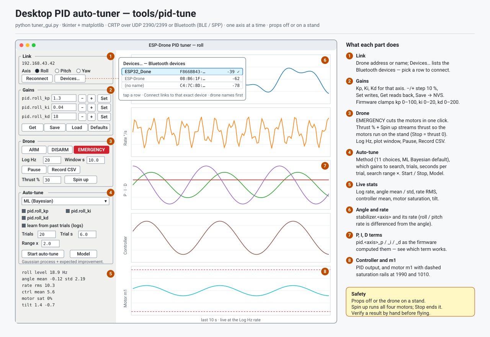
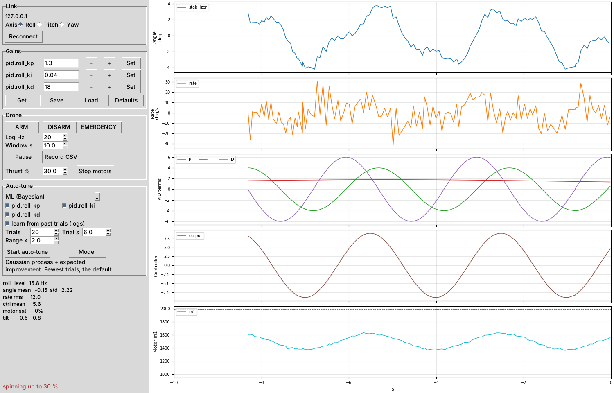

# PID tuner guide — the desktop app (`tools/pid-tune`)

A step-by-step guide to tuning the drone's PID gains from a computer with
`tuner_gui.py`. For the full reference (all eleven search methods, the cost
formula, the log files) see [tools/pid-tune/README.md](../tools/pid-tune/README.md).
**Tiếng Việt:** [PID_TUNER_GUIDE.vi.md](PID_TUNER_GUIDE.vi.md).



---

## 1. What it does, in one paragraph

The drone corrects itself with three PID controllers — roll, pitch and yaw —
each with three gains: **Kp**, **Ki** and **Kd**. This tool connects to the
drone over Wi-Fi, shows live graphs of what each controller is doing, lets you
change the gains by hand, and can search for good gains on its own
(**auto-tune**) while the drone sits on a stand. One axis at a time.

*Why a desktop tool when the phone apps can tune too?* A big screen shows five
live graphs at once, the P, I and D terms separately, and a model of which gains
scored best — things that do not fit on a phone.

---

## 2. Before you start — safety

| Rule | Why |
|---|---|
| **Props off** for your first session, or the drone **held by a tuning stand** that lets only one axis turn | **Spin up** runs all four motors. A drone that is free to fly will fly. |
| Know where **EMERGENCY** is (Drone panel, red) | One click cuts the motors — no confirmation dialog, on purpose. |
| Battery charged (above 3.7 V) | Below 3.3 V the firmware refuses to arm, and a sagging battery changes how the drone responds mid-run. |
| Change one thing at a time | If two gains change and the drone shakes, you cannot tell which one did it. |

Stopping is built in at three levels: **Stop motors** and **EMERGENCY** drop
thrust to zero (the board disarms), and if the program crashes or the Wi-Fi
drops, the firmware's failsafe stops the motors within 0.5 seconds.

---

## 3. Install

You need **Python 3.9 or newer** with **tkinter**, **numpy** and **matplotlib**.

| System | Commands |
|---|---|
| **Windows** | Install Python from python.org (tkinter is included), then `py -m pip install numpy matplotlib` |
| **macOS** | `brew install python-tk` (or the python.org installer), then `python3 -m pip install numpy matplotlib` |
| **Ubuntu / Debian** | `sudo apt install python3-tk python3-numpy python3-matplotlib` |

Check it: `python3 -c "import tkinter, numpy, matplotlib; print('ok')"`.

Then get the code (the `tools/pid-tune` folder of this repository) and, without
any hardware, run the self-test:

```sh
cd tools/pid-tune
python3 selftest.py          # ends with "all tests passed"
```

The self-test talks to a fake drone built from the firmware's own reply
formats, so if it passes, the program and the firmware agree on every byte.

---

## 4. Connect

1. Power the drone and wait for the gyro calibration (keep it flat and still
   for about 6 seconds).
2. Join its Wi-Fi from the computer: **ESP-Drone**, password **12345678** — or
   use Bluetooth instead (the drone needs link profile 2/3/6, see
   [PROTOCOL.md](../PROTOCOL.md) §8).
3. Start the tuner:

   ```sh
   python3 tuner_gui.py                       # roll axis, drone at 192.168.43.42
   python3 tuner_gui.py --axis pitch          # another axis
   python3 tuner_gui.py --host esp-drone.local   # drone in station mode
   python3 tuner_gui.py --link ble            # Bluetooth LE, drone ESP32_Done
   ```

If the first contact fails the window still opens — the status line says what
to fix ("join the drone's WiFi first" for UDP), and **Reconnect** retries.
Over Bluetooth, press **Devices…** in the Link box: it lists the BLE
advertisers (or, for SPP, the paired devices) with signal strength, and
connecting to a picked row goes to that exact device by address — no typing,
and two drones with the same name stay apart.

---

## 5. The window



*The screenshot is the real program, running against the self-test's fake drone
with made-up motion, so the curves are an illustration.*

| # | Part | What you do there |
|---|---|---|
| 1 | **Link** | Pick the link (UDP / BLE / SPP) and the axis (Roll / Pitch / Yaw). **Devices…** lists Bluetooth devices to pick and connect to directly. Reconnect after a drop. |
| 2 | **Gains** | Kp, Ki, Kd for that axis. Type a value and press **Set** (or Enter), or use **−** / **+** for 10 % steps. **Get** reads the drone, **Save** keeps the gains after power-off, **Load** / **Defaults** reload. |
| 3 | **Drone** | **Thrust %** and **Spin up / Stop motors**; **EMERGENCY**; telemetry rate; plot length; Pause; Record CSV. |
| 4 | **Auto-tune** | Method, which gains to search, number of trials, seconds per trial, search range. **Start**, **Model**. |
| 5 | **Live stats** | Numbers for what the graphs show: angle mean and spread, rate, motor saturation, tilt. |
| 6–8 | **Graphs** | Angle, rate, the P/I/D terms, controller output, and motor m1 with its limits (dashed red). |

The firmware keeps every gain inside a safe box — Kp 0–100, Ki 0–20, Kd 0–200 —
so a typo cannot send an absurd value. The value shown after **Set** is what
the drone actually stored.

---

## 6. A first session (props off, about 10 minutes)

The goal is to see the controller react, not to tune yet.

1. Props **off**. Start the tuner on **Roll**. Press **Get** — the default gains
   appear (Kp 1.3, Ki 0.04, Kd 18).
2. Set **Thrust %** to 25 and press **Spin up**, then confirm. The motors start
   after half a second and ramp up over one second.
3. Tilt the drone gently by hand to the right and back. Watch:
   - **Angle** follows your hand.
   - **P** (green) jumps with the tilt, **D** (purple) spikes while you move,
     **I** (red) creeps while you hold the tilt.
   - **Motor m1** changes speed as the controller pushes back.
4. Press **Stop motors**.

*Why do this first?* It proves the link, the logging and the signs all work.
If the low side's motors slow down instead of speeding up when you tilt, a sign
is wrong — stop and check before going further (course slides 75 and 81).

---

## 7. Tuning by hand (on a stand, props on)

Tune **roll**, then **pitch** (usually the same numbers), then **yaw**.

1. Set **Ki = 0**. Start from the defaults for Kp and Kd.
2. **Spin up** at a thrust where the drone just floats on the stand (often
   30–40 %).
3. **Raise Kp** with **+** until the angle starts to shake quickly, then go back
   about 30 %.
   *Example:* shaking starts at Kp 2.0 → use about 1.4.
4. **Raise Kd** until a quick push no longer makes it bounce. Too much Kd makes
   the motors buzz and run hot — back off when you hear it.
5. **Add Ki** a little at a time until the angle stays level instead of slowly
   leaning.
6. **Stop motors**, then **Save**. (Save is refused while the drone is armed,
   because writing flash pauses the processor.)

Watch the **P / I / D** graph while you do it: it shows which term is doing the
work, which a single "output" line hides.

---

## 8. Auto-tune (on a stand, props on)

1. **Spin up** first at your floating thrust. If you press Start without the
   motors running, the tuner asks — a still drone gives every gain set the same
   score, so the result would mean nothing.
2. Pick a **method**. Keep **ML (Bayesian)** unless you have a reason: it needs
   the fewest trials.
3. Tick the gains to search. *Tip:* tune Kp and Kd first with Ki unticked, then
   run again with only Ki ticked — "learn from past trials" lets the second run
   start from what the first one learned.
4. Leave **Trials 20**, **Trial s 6**, **Range × 2** for a first run (about
   4 minutes). Range × 2 searches from half to twice each current gain.
5. Press **Start auto-tune**. Each trial writes a gain set, watches the drone for
   the trial time and scores it. If the drone tips past 25°, the trial ends,
   the best gains so far are put back, and the tuner waits until the drone is
   level for 1.5 s.
6. Open **Model** to see the cost of every trial and the model's map.
7. When it finishes, the best gains are written to the drone. **Stop motors**,
   check the result by hand, then **Save**.

*Why is the result not just the luckiest trial?* One quiet window can happen
by chance. The tuner picks the gains the model *predicts* are best across all
the trials, which averages out the noise.

---

## 9. Troubleshooting

| You see | Cause | Fix |
|---|---|---|
| `no reply from 192.168.43.42` in the status line | Computer not on the drone's Wi-Fi | Join **ESP-Drone** / 12345678, then **Reconnect** |
| `BLE link lost` in the status line | The Bluetooth link dropped mid-session (range, battery, drone rebooted) | Press **Reconnect** — it rebuilds the link, even to the same device |
| **Devices…** finds nothing | Link box is on UDP, or the drone is not on a Bluetooth profile | Switch the Link box to BLE or SPP; set the drone's `LINK` to 2/3/6 |
| BLE connects but nothing replies | The drone was reached by a stale name match | Press **Devices…** and pick the drone row (connects by address) |
| `arm: refused by the drone` | Not in MANUAL, or battery below 3.3 V | Use **Spin up** (it arms by itself); charge the battery |
| Motors stop after a moment | The setpoint stream stopped (Wi-Fi drop, Stop, EMERGENCY) | Check the link, then Spin up again |
| `save: refused by the drone` | Drone still armed | **Stop motors**, then Save |
| Graphs flat, stats show 0 Hz | Log blocks not running | **Reconnect**, or lower **Log Hz** to 20 |
| Every auto-tune trial scores the same | Motors not spinning, or drone clamped too tight | Spin up; let the axis move freely on the stand |
| Gain changes back after typing | The firmware clamped it to its safe range | Use a value inside Kp 0–100, Ki 0–20, Kd 0–200 |

---

## 10. Files it writes

| File | Contents |
|---|---|
| `ml_tune_log.csv` (next to the program) | One row per auto-tune trial: gains, cost, whether it tipped, and the measured stats. Used by "learn from past trials". |
| Your **Record CSV** file | Every telemetry sample while recording, for your own analysis. |

---

## Questions to understand it more deeply

1. Why does the tuner have to keep sending setpoints just to keep the motors
   running? *(Hint: what does the firmware treat as proof the link is alive in
   MANUAL?)*
2. Why tune Kp before Ki? *(Hint: what does Ki do with an error that P would
   already remove?)*
3. Why search gains on a log scale (half to double) instead of adding a fixed
   amount? *(Hint: is Kp 0.1 → 0.2 a small change or a big one?)*
4. Why can a gain set that scores well on the stand still fly badly? *(Hint:
   one axis free on a stand, three axes free in the air.)*

Sources: [tools/pid-tune/README.md](../tools/pid-tune/README.md),
`tools/pid-tune/tuner_gui.py`, `drone.py`, `ml_tune.py`, and the firmware
[`Esp32_drone/Esp32_drone.ino`](../Esp32_drone/Esp32_drone.ino)
(`armUpdate()`, `crtpHandleFlightControl()`, `paramClampF()`, the failsafe in
`loop()`).
