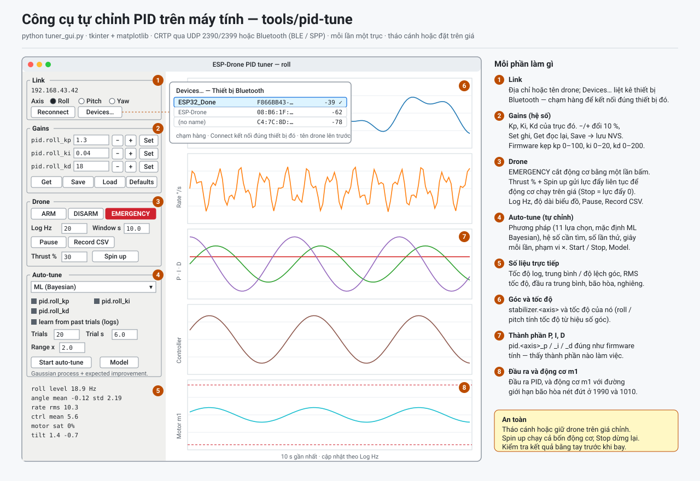

# Hướng dẫn chỉnh PID — ứng dụng máy tính (`tools/pid-tune`)

Hướng dẫn từng bước để chỉnh hệ số PID của drone từ máy tính bằng
`tuner_gui.py`. Tài liệu tham khảo đầy đủ (mười một phương pháp tìm kiếm, công
thức chấm điểm, các file log) nằm ở [tools/pid-tune/README.md](../tools/pid-tune/README.md).
**English:** [PID_TUNER_GUIDE.md](PID_TUNER_GUIDE.md).



---

## 1. Công cụ làm gì, trong một đoạn

Drone tự sửa sai bằng ba bộ điều khiển PID — roll, pitch và yaw — mỗi bộ có ba
hệ số: **Kp**, **Ki** và **Kd**. Công cụ này kết nối với drone qua Wi-Fi, vẽ
biểu đồ trực tiếp những gì mỗi bộ điều khiển đang làm, cho bạn đổi hệ số bằng
tay, và có thể tự tìm hệ số tốt (**auto-tune**) khi drone đặt trên giá. Mỗi lần
chỉnh một trục.

*Vì sao cần công cụ trên máy tính khi điện thoại cũng chỉnh được?* Màn hình lớn
hiện cùng lúc năm biểu đồ, tách riêng P, I và D, và một mô hình cho biết hệ số
nào đạt điểm tốt nhất — những thứ không vừa màn hình điện thoại.

---

## 2. Trước khi bắt đầu — an toàn

| Quy tắc | Vì sao |
|---|---|
| **Tháo cánh** ở buổi đầu, hoặc drone được **giữ trên giá chỉnh** chỉ cho một trục xoay | **Spin up** chạy cả bốn động cơ. Drone được thả tự do sẽ bay. |
| Biết nút **EMERGENCY** ở đâu (khung Drone, màu đỏ) | Một lần bấm là cắt động cơ — cố ý không có hộp xác nhận. |
| Pin đầy (trên 3,7 V) | Dưới 3,3 V firmware không cho arm, và pin sụt áp làm drone phản ứng khác đi giữa chừng. |
| Mỗi lần chỉ đổi một thứ | Đổi hai hệ số mà drone rung thì không biết cái nào gây ra. |

Việc dừng có sẵn ở ba mức: **Stop motors** và **EMERGENCY** đưa lực đẩy về 0
(bo mạch tự disarm), và nếu chương trình bị treo hoặc mất Wi-Fi, failsafe của
firmware dừng động cơ trong vòng 0,5 giây.

---

## 3. Cài đặt

Cần **Python 3.9 trở lên** cùng **tkinter**, **numpy** và **matplotlib**.

| Hệ điều hành | Lệnh |
|---|---|
| **Windows** | Cài Python từ python.org (có sẵn tkinter), rồi `py -m pip install numpy matplotlib` |
| **macOS** | `brew install python-tk` (hoặc bộ cài python.org), rồi `python3 -m pip install numpy matplotlib` |
| **Ubuntu / Debian** | `sudo apt install python3-tk python3-numpy python3-matplotlib` |

Kiểm tra: `python3 -c "import tkinter, numpy, matplotlib; print('ok')"`.

Rồi lấy mã nguồn (thư mục `tools/pid-tune` của repo này) và chạy bài tự kiểm
tra, không cần phần cứng:

```sh
cd tools/pid-tune
python3 selftest.py          # kết thúc bằng "all tests passed"
```

Bài tự kiểm tra nói chuyện với một drone giả được dựng theo đúng định dạng trả
lời của firmware, nên nếu nó đạt, chương trình và firmware khớp nhau từng byte.

---

## 4. Kết nối

1. Bật nguồn drone và chờ hiệu chuẩn gyro (để phẳng và yên khoảng 6 giây).
2. Cho máy tính vào Wi-Fi của drone: **ESP-Drone**, mật khẩu **12345678**.
3. Chạy công cụ:

   ```sh
   python3 tuner_gui.py                       # trục roll, drone ở 192.168.43.42
   python3 tuner_gui.py --axis pitch          # trục khác
   python3 tuner_gui.py --host esp-drone.local   # drone ở chế độ station
   ```

Nếu nó dừng với `no reply from 192.168.43.42`, máy tính chưa vào mạng của drone.
Không có lỗi gì khác — vào **ESP-Drone** rồi chạy lại.

---

## 5. Cửa sổ chương trình


*Ảnh chụp là chương trình thật, chạy với drone giả của bài tự kiểm tra và
chuyển động bịa ra, nên các đường cong chỉ là minh họa.*

| # | Phần | Bạn làm gì ở đó |
|---|---|---|
| 1 | **Link** | Chọn trục (Roll / Pitch / Yaw). Reconnect sau khi mất Wi-Fi. |
| 2 | **Gains** | Kp, Ki, Kd của trục đó. Gõ giá trị rồi bấm **Set** (hoặc Enter), hoặc dùng **−** / **+** để đổi 10 %. **Get** đọc từ drone, **Save** giữ hệ số sau khi tắt nguồn, **Load** / **Defaults** nạp lại. |
| 3 | **Drone** | **Thrust %** và **Spin up / Stop motors**; **EMERGENCY**; tốc độ telemetry; độ dài biểu đồ; Pause; Record CSV. |
| 4 | **Auto-tune** | Phương pháp, hệ số cần tìm, số lần thử, số giây mỗi lần thử, phạm vi tìm. **Start**, **Model**. |
| 5 | **Số liệu trực tiếp** | Con số cho những gì biểu đồ hiện: trung bình và độ phân tán của góc, tốc độ, độ bão hòa động cơ, độ nghiêng. |
| 6–8 | **Biểu đồ** | Góc, tốc độ, các thành phần P/I/D, đầu ra bộ điều khiển, và động cơ m1 cùng giới hạn (nét đứt đỏ). |

Firmware giữ mọi hệ số trong vùng an toàn — Kp 0–100, Ki 0–20, Kd 0–200 — nên
gõ nhầm cũng không gửi được giá trị vô lý. Giá trị hiện sau khi **Set** là giá
trị drone thật sự đã lưu.

---

## 6. Buổi đầu tiên (tháo cánh, khoảng 10 phút)

Mục tiêu là thấy bộ điều khiển phản ứng, chưa phải chỉnh.

1. **Tháo cánh**. Mở công cụ ở trục **Roll**. Bấm **Get** — hệ số mặc định hiện
   ra (Kp 1,3, Ki 0,04, Kd 18).
2. Đặt **Thrust %** là 25 và bấm **Spin up**, rồi xác nhận. Động cơ bắt đầu sau
   nửa giây và tăng dần trong một giây.
3. Nghiêng nhẹ drone bằng tay sang phải rồi trả lại. Quan sát:
   - **Góc** đi theo tay bạn.
   - **P** (xanh lá) nhảy theo độ nghiêng, **D** (tím) vọt lên khi tay đang
     di chuyển, **I** (đỏ) tăng dần khi bạn giữ nghiêng.
   - **Động cơ m1** đổi tốc độ khi bộ điều khiển đẩy ngược lại.
4. Bấm **Stop motors**.

*Vì sao làm bước này trước?* Nó chứng minh kết nối, log và các dấu đều đúng.
Nếu khi nghiêng, động cơ phía thấp lại chậm đi thay vì nhanh lên, có một dấu bị
sai — dừng lại và kiểm tra trước khi đi tiếp (slide 75 và 81 của khóa học).

---

## 7. Chỉnh bằng tay (trên giá, có cánh)

Chỉnh **roll**, rồi **pitch** (thường cùng số), rồi **yaw**.

1. Đặt **Ki = 0**. Bắt đầu với Kp và Kd mặc định.
2. **Spin up** ở mức lực đẩy mà drone vừa nổi trên giá (thường 30–40 %).
3. **Tăng Kp** bằng **+** cho tới khi góc bắt đầu rung nhanh, rồi giảm lại
   khoảng 30 %.
   *Ví dụ:* rung bắt đầu ở Kp 2,0 → dùng khoảng 1,4.
4. **Tăng Kd** cho tới khi một cú đẩy nhanh không còn làm drone nảy. Kd quá
   lớn làm động cơ rít và nóng — nghe thấy thì giảm lại.
5. **Thêm Ki** từng chút cho tới khi góc giữ thăng bằng thay vì nghiêng dần.
6. **Stop motors**, rồi **Save**. (Save bị từ chối khi drone đang arm, vì ghi
   flash làm bộ xử lý dừng một lúc.)

Theo dõi biểu đồ **P / I / D** khi chỉnh: nó cho biết thành phần nào đang làm
việc chính, điều mà một đường “đầu ra” duy nhất che mất.

---

## 8. Auto-tune (trên giá, có cánh)

1. **Spin up** trước ở mức lực đẩy vừa nổi. Nếu bấm Start khi động cơ chưa
   chạy, công cụ sẽ hỏi lại — drone đứng yên cho mọi bộ hệ số cùng một điểm, nên
   kết quả sẽ vô nghĩa.
2. Chọn **phương pháp**. Giữ **ML (Bayesian)** nếu không có lý do khác: nó cần ít
   lần thử nhất.
3. Đánh dấu các hệ số cần tìm. *Mẹo:* chỉnh Kp và Kd trước, bỏ chọn Ki, rồi
   chạy lại chỉ với Ki — “learn from past trials” cho lần chạy thứ hai bắt đầu
   từ những gì lần đầu đã học.
4. Để **Trials 20**, **Trial s 6**, **Range × 2** cho lần đầu (khoảng 4 phút).
   Range × 2 tìm từ một nửa đến gấp đôi mỗi hệ số hiện tại.
5. Bấm **Start auto-tune**. Mỗi lần thử ghi một bộ hệ số, quan sát drone trong
   thời gian thử và chấm điểm. Nếu drone nghiêng quá 25°, lần thử kết thúc, bộ
   hệ số tốt nhất tới lúc đó được đặt lại, và công cụ chờ drone thăng bằng 1,5 s.
6. Mở **Model** để xem điểm của mọi lần thử và bản đồ của mô hình.
7. Khi xong, bộ hệ số tốt nhất được ghi vào drone. **Stop motors**, kiểm tra
   kết quả bằng tay, rồi **Save**.

*Vì sao kết quả không đơn giản là lần thử may mắn nhất?* Một khoảng yên tĩnh có
thể xảy ra tình cờ. Công cụ chọn bộ hệ số mà mô hình *dự đoán* là tốt nhất qua
mọi lần thử, nên nhiễu được lấy trung bình.

---

## 9. Xử lý sự cố

| Bạn thấy | Nguyên nhân | Cách sửa |
|---|---|---|
| `no reply from 192.168.43.42` khi khởi động | Máy tính chưa vào Wi-Fi của drone | Vào **ESP-Drone** / 12345678 |
| `arm: refused by the drone` | Không ở MANUAL, hoặc pin dưới 3,3 V | Dùng **Spin up** (nó tự arm); sạc pin |
| Động cơ dừng sau một lúc | Luồng setpoint dừng (mất Wi-Fi, Stop, EMERGENCY) | Kiểm tra kết nối, rồi Spin up lại |
| `save: refused by the drone` | Drone vẫn đang arm | **Stop motors**, rồi Save |
| Biểu đồ phẳng, số liệu báo 0 Hz | Khối log không chạy | **Reconnect**, hoặc giảm **Log Hz** về 20 |
| Mọi lần thử auto-tune cùng điểm | Động cơ không quay, hoặc giá kẹp quá chặt | Spin up; để trục xoay tự do trên giá |
| Hệ số tự đổi lại sau khi gõ | Firmware đã kẹp về vùng an toàn | Dùng giá trị trong Kp 0–100, Ki 0–20, Kd 0–200 |

---

## 10. Các file công cụ ghi ra

| File | Nội dung |
|---|---|
| `ml_tune_log.csv` (cạnh chương trình) | Mỗi lần thử auto-tune một dòng: hệ số, điểm, có bị nghiêng ngã không, và số liệu đo được. Dùng cho “learn from past trials”. |
| File **Record CSV** của bạn | Mọi mẫu telemetry trong lúc ghi, để bạn tự phân tích. |

---

## Câu hỏi để hiểu sâu hơn

1. Vì sao công cụ phải liên tục gửi setpoint chỉ để giữ động cơ quay? *(Gợi ý:
   ở MANUAL, firmware coi điều gì là bằng chứng kết nối còn sống?)*
2. Vì sao chỉnh Kp trước Ki? *(Gợi ý: Ki làm gì với một sai số mà P đã loại bỏ
   được?)*
3. Vì sao tìm hệ số theo thang log (từ một nửa đến gấp đôi) thay vì cộng một
   lượng cố định? *(Gợi ý: Kp 0,1 → 0,2 là thay đổi nhỏ hay lớn?)*
4. Vì sao một bộ hệ số đạt điểm tốt trên giá vẫn có thể bay kém? *(Gợi ý: trên
   giá một trục tự do, trên không ba trục tự do.)*

Nguồn: [tools/pid-tune/README.md](../tools/pid-tune/README.md),
`tools/pid-tune/tuner_gui.py`, `drone.py`, `ml_tune.py`, và firmware
[`Esp32_drone/Esp32_drone.ino`](../Esp32_drone/Esp32_drone.ino)
(`armUpdate()`, `crtpHandleFlightControl()`, `paramClampF()`, failsafe trong
`loop()`).
