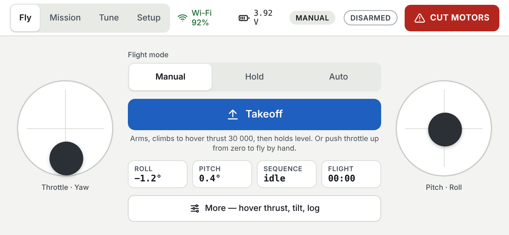
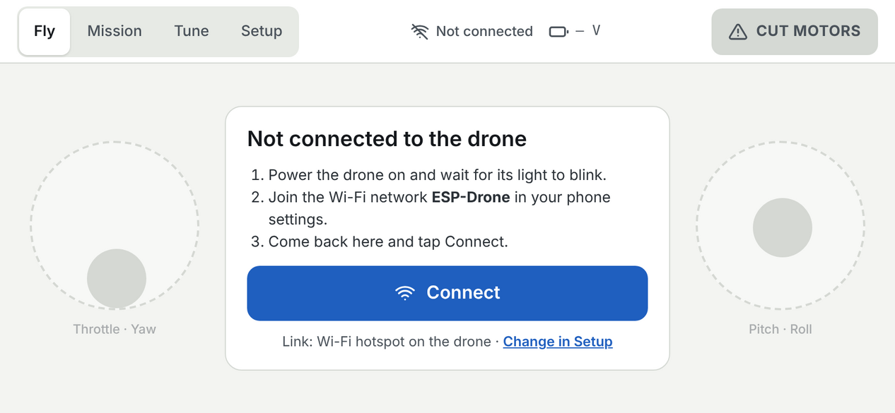
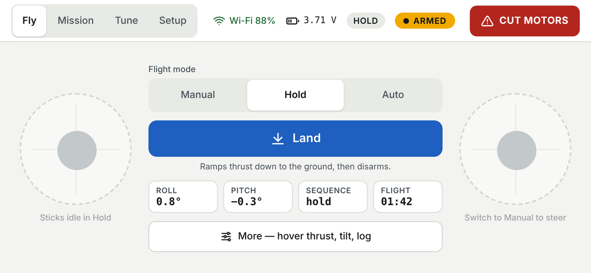
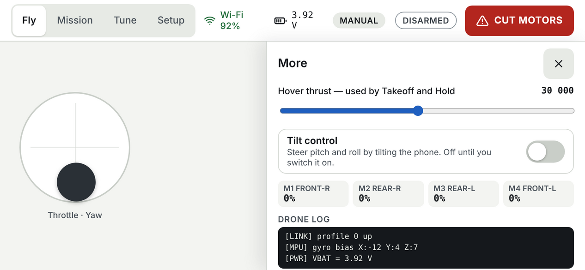
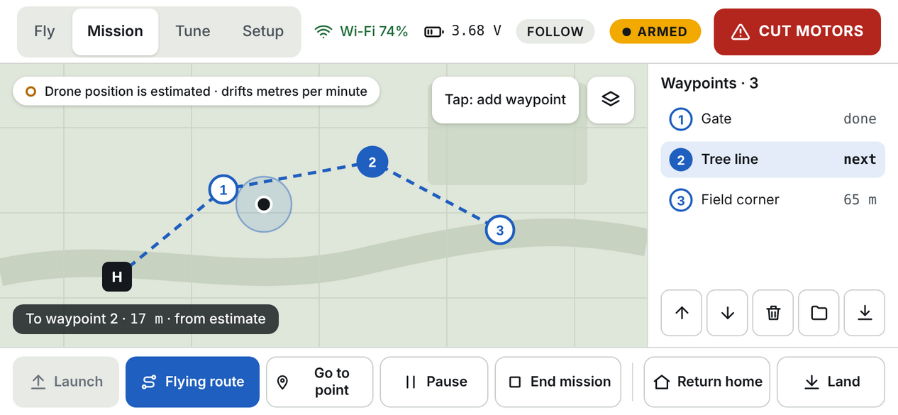
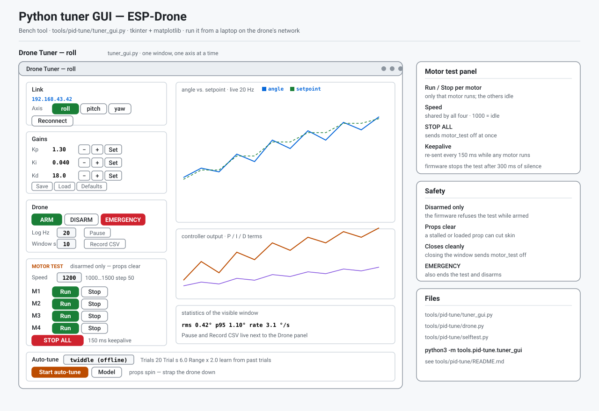

# Pilot's guide

*[Tiếng Việt](USER_GUIDE.vi.md)*

How to fly the XW_Z1 ESP32 drone with the Android and iOS apps: what every
screen does, how the safety features behave, and a checklist for the first
flight.

New here? Install the firmware and an app first — see
**[INSTALL.md](INSTALL.md)**. For the wire protocol, see
**[../PROTOCOL.md](../PROTOCOL.md)**.

> **Before anything else:** this board has **only a motion sensor (MPU6500)**.
> No barometer, no GPS, no compass. So **Hold keeps a thrust level, not a
> height**, and the drone's position on the map is **estimated** and drifts by
> metres per minute. The apps say this on screen too.

---

## Contents

1. [Safety rules](#1-safety-rules)
2. [The screen layout](#2-the-screen-layout)
3. [Connecting](#3-connecting)
4. [The Fly screen](#4-the-fly-screen)
5. [CUT MOTORS](#5-cut-motors)
6. [Arming and disarming](#6-arming-and-disarming)
7. [What the drone does on its own](#7-what-the-drone-does-on-its-own)
8. [Mission (GPS)](#8-mission-gps)
9. [Indoor Map](#9-indoor-map)
10. [Tune (PID)](#10-tune-pid)
11. [Bench — the Python tuner GUI](#11-bench--the-python-tuner-gui)
12. [Setup](#12-setup)
13. [First-flight checklist](#13-first-flight-checklist)
14. [Troubleshooting](#14-troubleshooting)
15. [Known limits](#15-known-limits)

---

## 1. Safety rules

1. **Know where CUT MOTORS is before you arm.** It is the red button at the
   top-right of every screen. It stops the motors at once — the drone falls.
2. **First flights with props off, then with the drone held or tied down.**
3. **Fly over grass, away from people**, with line of sight to the drone.
4. **Watch the battery in the header.** At 3.50 V it turns amber, at 3.30 V
   red. Land when it turns amber.
5. **Do not rely on Hold, Follow or Return home to keep the drone in place.**
   They drift (see the box above).
6. **Change the Wi-Fi password** (`WIFI_AP_PASS` in the sketch) before flying
   anywhere public — anyone who joins the network can control the drone.

---

## 2. The screen layout

Every screen has the same header, so the important things never move.

*Design mockup of the Fly screen. The Android and iOS apps follow this
layout; small details differ by platform.*

| Header item | What it tells you |
|---|---|
| **Fly · Mission · Indoor · Tune · Setup** | The five sections. The current one is white. |
| **Wi-Fi / Link** | Green when connected, with signal strength. Grey = not connected. |
| **Battery (volts)** | The real cell voltage. Ink = OK, **amber below 3.50 V**, **red below 3.30 V**. |
| **Mode chip** | MANUAL, HOLD, AUTO, FOLLOW or RTH — what the drone reports. |
| **ARMED / DISARMED** | **Amber "● ARMED" means the motors can spin.** Grey outline = safe. |
| **CUT MOTORS** | Emergency motor stop. See [section 5](#5-cut-motors). |

The mode and ARMED chips appear about a second after connecting, once the
drone's first status report arrives.

**Moving between sections**

- **Fly** is home. Mission, Indoor Map and Tune open from it; closing them (or
  tapping *Fly*) returns there.
- **Switching sections is blocked while a mission is flying or auto-tune is
  running** — the app tells you why. Land, end the mission, stop the tuner, or
  use CUT MOTORS first. This stops you from accidentally closing the screen
  that is flying the drone.

---

## 3. Connecting

When the app is not connected, the Fly screen shows what to do next:

1. **Power the drone on.**
2. **Wi-Fi hotspot (default):** join the Wi-Fi network **ESP-Drone**
   (password `12345678`) in your phone settings.
   **Bluetooth LE:** keep the phone's Bluetooth on.
3. **Tap Connect.**

The card shows which link type the app will use. To change it, open **Setup**.
CUT MOTORS is greyed out while nothing is connected — there is nothing to stop.

| Link | Android | iOS | Notes |
|---|---|---|---|
| Wi-Fi hotspot (drone hosts `ESP-Drone`) | ✅ | ✅ | Simplest. Default. |
| Wi-Fi network (drone joins your router) | ✅ | ✅ | Set it up on the serial console: `sta <ssid> <pass>` |
| Bluetooth LE | ✅ | ✅ | |
| Bluetooth Classic | ✅ | ❌ | iOS only allows it for MFi accessories |

How to switch the drone's link is in [INSTALL.md § Connect](INSTALL.md#4-connect).

---

## 4. The Fly screen

The screen you hold while flying. Left stick = throttle and yaw, right stick =
pitch and roll (Mode 2). In the centre:

| Part | What it does |
|---|---|
| **Flight mode** | Manual · Hold · Auto. Follow and Return home are run from the Mission screen; when one of them is active, none of these three is highlighted and the mode chip shows it. |
| **Main button** | **Takeoff** when on the ground, **Land** when armed. It changes by itself. |
| **Caption** | What the main button will do, in one line. |
| **ROLL · PITCH** | The drone's tilt in degrees, from its own sensor. |
| **SEQUENCE** | Where the Auto sequence is: idle, takeoff, hold, land. |
| **FLIGHT** | Time since the drone armed (mm:ss). Use it as a battery timer. |
| **More** | Everything you don't need every second (below). |

### Flight modes

| Mode | Sticks | What the drone does |
|---|---|---|
| **Manual** | Steer | You fly. Pushing throttle up from zero arms it. |
| **Hold** | Ignored | Stays level, keeps its heading, holds a **thrust level** (not a height). |
| **Auto** | Ignored | Takeoff ramp → hold → land ramp → disarm. |
| Follow | Ignored | Tilts toward the target the phone sends (Mission screen). Estimated position. |
| Return home | Ignored | Tilts back toward the launch point. Estimated position. |

**Takeoff** switches to Auto: it arms, ramps thrust up to the hover thrust over
about 2 s, then holds level. **Land** ramps thrust down over about 2.5 s and
disarms. Pressing Takeoff again while already climbing or hovering does
nothing — it never restarts the climb from zero.

### Sticks fade when they don't steer

In Hold and Auto the sticks are dimmed, because the drone ignores them. Switch
to **Manual** to steer by hand.

### The More panel

| Item | Android | iOS |
|---|---|---|
| **Hover thrust** slider (8 000–55 000) — used by Takeoff and Hold | ✅ | ✅ |
| **Tilt control** — steer pitch/roll by tilting the phone. Off until you switch it on | ✅ | — |
| **Yaw on the left stick** — off means the yaw stick is ignored | — | ✅ |
| **Arm / Disarm** buttons (for the bench) | ✅ | via *All flight modes…* |
| **All flight modes and sequence…** — the full mode list incl. Follow / RTH | — | ✅ |
| **Stick output** — what the sticks are sending | ✅ | — |
| **Drone log** — messages from the drone | ✅ | ✅ |
| **Disconnect** | ✅ | — |
| LED ring / headlight / buzzer | only if the drone has them (this board does not) | — |

Hover thrust is a **thrust**, not a height. Start low (around 30 000) and raise
it until Takeoff lifts off cleanly. It drifts as the battery drains.

---

## 5. CUT MOTORS

The red button at the top-right of every screen. **It stops all four motors
immediately and disarms. The drone falls.** Use it when anything goes wrong.

| Screen | How to use it |
|---|---|
| **Fly** | **Tap twice within 3 seconds.** The first tap turns it orange and shows *TAP AGAIN*; the second tap cuts. If you don't tap again, it goes back to red. |
| **Mission, Tune** | **One tap** cuts at once. On Tune it also stops the auto-tuner. |

The Fly screen needs two taps because your thumbs are on the sticks right next
to it; a stray touch must not drop the drone. Mission and Tune are used with
the drone further away, where speed matters more.

> The button looks the same on every screen but confirms differently. Practise
> it on the bench (props off) on each screen before you fly.

---

## 6. Arming and disarming

**Armed** means the motors can spin. The header shows **● ARMED** in amber.

### Ways to arm

| How | When it works |
|---|---|
| **Takeoff** button | Battery OK. Arms and climbs. |
| **Throttle up from zero** (phone, Manual) | The app must first see the throttle at zero. A phone that connects with the throttle already up will **not** spin the props. |
| **Arm** button | Only from idle: Manual with throttle at zero, or Auto before a takeoff. Refused in Hold, Follow and RTH, where the motors would jump straight to hover thrust. |
| **RC transmitter** | Throttle low + yaw right for 1 s, or the arm switch (CH5) high. |

**Every way is refused if the battery is below 3.30 V.** The drone log says
*"arm refused: low battery"*.

### Ways to disarm

- **Land** — ramps down, then disarms.
- **Throttle back to zero** (phone, Manual).
- **Disarm** button (More panel on Android, *All flight modes* on iOS).
- **RC transmitter:** throttle low + yaw left for 1 s, or the arm switch low.
- **CUT MOTORS** — instant.

---

## 7. What the drone does on its own

### Link lost (failsafe)

If the drone hears nothing for **0.5 s** while armed, it **cuts the motors**,
disarms and returns to Manual.

- In **Manual**, "something" means the phone's stick stream (or a valid RC
  signal). Other messages don't count, because the stick stream *is* the
  control.
- In **Hold, Auto, Follow and RTH**, any message from the phone counts.
- From an **RC receiver**, frames the receiver itself marks as *failsafe* or
  *lost* are ignored, so a receiver that has lost your transmitter also
  triggers the cut.

### Low battery

If the battery stays below **3.30 V for 3 seconds**:

- In **Hold, Auto, Follow, RTH** (phone control): the drone **lands itself**,
  and refuses mode changes until it has disarmed.
- In **Manual** or on the RC transmitter: the drone log warns *"battery
  critical: land now"* every 2 s. Land.

A short sag when you punch the throttle does not trigger this — the voltage is
smoothed and must stay low for 3 s.

### Refused while armed

The drone will not **save settings to its memory** or **switch its link type**
while armed — both pause or restart the board.

---

## 8. Mission (GPS)

*Design reference. The buttons are arranged slightly differently on each
platform — see the tables below.*

The **phone's** GPS and compass define the launch point and direction. The
drone has no GPS; it **estimates** its position from its motion sensor, and
that estimate drifts. Treat Follow and Return home as "roughly towards", never
as precise.

**Before launch:** stand at the launch point with a good GPS fix, point the
phone the way the drone's nose points, then launch. The app refuses to launch
without a fix or a compass reading.

### Android

| Button | What it does |
|---|---|
| **Launch** | Records the launch point and direction, arms, takes off. |
| **Mission** | Flies the waypoint list in order. |
| **Go to here** | Flies to the point you tapped (tap mode: go-to). |
| **Pause / Resume** | Stops sending targets; the drone holds. |
| **End mission** | Stops navigating; the drone **holds** where it is. |
| **Return home** | Flies back toward the launch point. |
| **Land** | Lands and disarms. |
| **Map: …** | Switches satellite / street / terrain. |
| **Tap: …** | Whether tapping the map adds a waypoint or sets a go-to point. |
| ↑ ↓ 🗑 (icons) | Reorder or remove the selected waypoint. |
| 📁 💾 (icons) | Load / save a mission file (Mission Planner `.waypoints`). |

### iOS

| Control | What it does |
|---|---|
| **MISSION · GUIDED · RTL** | Which kind of navigation *Start mission* runs. |
| **Arm + ALIGN** | Records the launch point and direction, arms. |
| **Start mission** | Starts the selected navigation. |
| **Pause / Resume** | Stops sending targets; the drone holds. |
| **End mission** | Stops navigating and hands control back to the sticks. |
| Folder icon | Load a `.waypoints` file. |
| Bin icon | Clear the plan. |

Long-press the icon-only buttons (Android) or use VoiceOver (iOS) to hear their
names.

**Keep-out zones and corridors are drawn on this map, but not edited here.** The
map is read-only for those so the plan cannot change mid-flight; the editor is
the [Indoor Map](#9-indoor-map) page. If a waypoint is refused ("inside keep-out
zone") or a hold starts ("keep-out zone entered - holding"), the red shape you
see is the reason.

---

## 9. Indoor Map

*The Indoor Map editor, as a screen map. The iOS app
([ios-app.svg](ios-app.svg)) has the same tools in its own layout.*

The **Indoor** tab is the map-annotation editor — the place to tell the drone
about things the map cannot know on its own: where it must not fly, where it may
cross a keep-out zone, and where the air is unsteady. Everything you draw here
is shared with the [Mission](#8-mission-gps) page: the zones edited here are the
zones the mission runner obeys.

### The modes

One mode is active at a time (the current one is filled):

| Mode | How you draw | What it makes |
|---|---|---|
| **Select** | Tap a shape to pick it; drag its handles or body | Edits what is already on the map |
| **Keep-out** | Drag on the map to draw a rectangle | A red zone the drone will not fly into |
| **Wind** | Drag on the map to draw a rectangle | A zone where arrival needs a second look (unsteady air) |
| **Corridor** | Tap one endpoint, then the other | A green gate the drone may cross through |
| **Go to** | Tap a point | A target for GUIDED mode — start it from the Mission page |

Placement is placement-only: while a drawing mode is active, touching the map
draws (or does nothing) — it does not select shapes or drop waypoints. A pinch
still zooms. When a shape is placed it snaps to **5° angles and whole metres**.

### Editing a shape

Switch to **Select**, then tap the shape. It wears the editing handles:

| Handle | Where | Does |
|---|---|---|
| ✕ red | first corner | deletes the shape (tap, no drag) |
| ✛ / ↻ | second corner | moves a corridor endpoint / rotates a zone |
| ↖↘ | third corner | scales a zone |
| body | anywhere on the shape | drags the whole thing |

**Delete selected**, **Clear all** and **Center** sit above the tiles; the tiles
row lists every shape ("Keep-out 1", "Corridor 1", …) and every waypoint
("WP 1", …) — tap a tile to select and centre the map on it.

The screen maps of both apps: [android-app.svg](android-app.svg) ·
[ios-app.svg](ios-app.svg).

---

## 10. Tune (PID)

For tuning the stabiliser on the bench. **Auto-tune spins the props. Strap the
drone to a stand or hold it tethered.**

| Part | What it does |
|---|---|
| **Axis** | Roll, pitch or yaw — tune one at a time. |
| **Charts** | Live angle vs. controller output, and the P / I / D terms. Pause and clear with the icon buttons. |
| **Gains** | Edit P, I and D. The drone limits every value to a safe range and rejects invalid numbers; the field shows what the drone actually stored. |
| **Save / Load / Defaults** | Save the gains to the drone's memory (disarmed only), load them back, or restore the defaults (not saved until you Save). |
| **Start auto-tune** | **Press and hold** (2 s on Android, 1.5 s on iOS) to start. |
| **Stop tuner** (Android) | Stops after the current trial. |
| **CUT MOTORS** | Cuts the motors **and** stops the tuner, one tap. |

---

## 11. Bench — the Python tuner GUI

*The bench window (`tools/pid-tune/tuner_gui.py`), as a screen map.*

The same tuning tools, plus bench tests, on a laptop connected to the drone's
network. See [tools/pid-tune/README.md](../tools/pid-tune/README.md) for how to
start it.

### Motor test

Run one motor at a time to check wiring and props after a repair. **Disarmed
only, props clear** — a spinning prop cuts.

| Part | What it does |
|---|---|
| **Speed** | Shared by all four motors. 1000 is idle; 1200 is a gentle spin. |
| **Run** (per motor) | Runs **that motor only** at the speed; the others idle. |
| **Stop** (per motor) | Stops that motor; the others keep whatever they were doing. |
| **STOP ALL** | Ends the whole test at once. |

The GUI re-sends the command every 150 ms while anything is running — the
firmware stops the test on its own after 300 ms of silence, and closing the
window sends it off. EMERGENCY ends it too. If the status says the test was not
acked, the drone is armed — disarm first.

---

## 12. Setup

| | Android | iOS |
|---|---|---|
| Opens | The settings screen: link type, controls, sensitivity | A menu: **Link — Wi-Fi or Bluetooth**, or **Sticks and sensitivity** |

After changing the link type, reconnect. To change the **drone's** side of the
link, use the serial console (`link <n>`) — see
[INSTALL.md](INSTALL.md#verify-the-flash).

---

## 13. First-flight checklist

Do every step. Do steps 1–6 **with the props off.**

1. **Charge the battery.** The header should read about 4.1 V when connected.
2. **Connect.** The mode chip and DISARMED appear within a second or two.
3. **Tilt the drone by hand.** ROLL and PITCH must follow: tip the right side
   down → roll changes; nose down → pitch changes. If a number moves the wrong
   way, **stop** and fix the sign settings in the sketch (`GYRO_*_SIGN`,
   `ACC_*_SIGN`) before going on.
4. **Arm, then CUT.** Tap Takeoff (or throttle up from zero), see **● ARMED**,
   then use CUT MOTORS. DISARMED must come back at once. Repeat on the Mission
   and Tune screens to feel the one-tap version.
5. **Link-loss test.** Arm, then turn the phone's Wi-Fi off. Within half a
   second the motors must stop.
6. **Motor direction.** Props off, arm, raise throttle a little: RF and LR spin
   **clockwise**, RR and LF **counter-clockwise** (seen from above).
7. **Props on, drone held or tied down.** Raise throttle slowly. Tilt it by
   hand — it should push back toward level, not further over. If it pushes
   *away* from level, CUT and stop.
8. **First hover.** In an open space: Takeoff with a low hover thrust, a finger
   on CUT MOTORS. Raise hover thrust in small steps (More panel) until it lifts
   off cleanly. Land.

The PID gains and the two navigation sign settings (`NAV_FWD_SIGN`,
`NAV_LEFT_SIGN`) are still defaults. Expect to tune before smooth flight, and
test Follow / Return home only after a stable hover.

---

## 14. Troubleshooting

| Symptom | Likely cause and fix |
|---|---|
| Mode / ARMED chips never appear | The status report isn't arriving. Reconnect; check the firmware is current. |
| Battery shows "— V" | Not connected, or no report yet. |
| *arm refused: low battery* in the log | Battery below 3.30 V (or the board is on USB with no battery — set `VBAT_ARM_CHECK` to 0 for bench work). |
| Throttle up doesn't arm | Bring throttle fully to zero first, then up. |
| Arm button refused | Only works from idle — Manual with throttle at zero, or Auto before takeoff. Use Takeoff instead. |
| Takeoff refused | Battery low, or already flying in another mode. |
| Motors cut suddenly in flight | Link lost for 0.5 s, or the RC receiver reported failsafe. Stay closer; check Wi-Fi signal in the header. |
| Drone landed by itself | Battery below 3.30 V for 3 s. |
| Can't switch section | A mission or auto-tune is running — end it, land, or CUT first. |
| Save / link change refused | The drone is armed. Disarm first. |
| Drone tilts further when pushed (props on) | Wrong sensor sign settings. Stop and fix before flying. |
| Hold climbs or sinks | Expected — Hold is a thrust level, not a height. Adjust hover thrust. |
| Follow / Return home goes the wrong way | Dead reckoning drift, or `NAV_FWD_SIGN` / `NAV_LEFT_SIGN` wrong. Test at low height. |
| Bluetooth Classic missing on iPhone | Expected — use Wi-Fi or Bluetooth LE. |

---

## 15. Known limits

- **No height, no position.** Only a motion sensor. See the box at the top.
- **CUT MOTORS confirms differently** on Fly (two taps) and Mission / Tune (one
  tap). See [section 5](#5-cut-motors).
- **Setup is not redesigned yet.** It opens the existing settings screens.
- **The redesigned app screens are new.** Build them in Android Studio and
  Xcode and check them on a phone before relying on them in flight.
- **PID gains and navigation signs are defaults.** They need tuning from real
  flights.
